<div align="center">

# WonderMaker ZR Ultra / Ultra-S: Raspberry Pi replacement

**Replace screen/host board with a Raspberry Pi running WonderMaker's own Klipper, Moonraker and Fluidd.**

**Related projects:** [wm-ultra-fluidd-acepro-panel](https://github.com/ducati1198/wm-ultra-fluidd-acepro-panel) (Fluidd Toolheads card, ACE Pro, [OrcaSlicer plugin](https://github.com/ducati1198/wm-ultra-fluidd-acepro-panel/tree/main/orca_plugin)) · [acepro-any-klipper](https://github.com/ducati1198/acepro-any-klipper) (ACE Pro on any Klipper printer)

[](LICENSE) 

</div>

> **Status:** tested with a fake home folder, on a fresh Raspberry Pi (install, doctor, Fluidd, Moonraker, Klipper loading the config) and on one WonderMaker screen board. **Not tested with a running printer yet.** Use at your own risk, see the [full disclaimer](#disclaimer-use-at-your-own-risk).

## Quick start

The idea: a Raspberry Pi takes over the job of the WonderMaker screen/host board (it runs Klipper, Moonraker and the web page). You copy WonderMaker's own software and your settings to it once; after that the Pi runs everything.

1. **Write the SD card** with Raspberry Pi Imager: *Raspberry Pi OS (Legacy, 64-bit) Lite* (Debian 12 Bookworm), username **`t13dp`**, SSH on, your Wi-Fi or a cable. Details in [2.1](#21-what-you-need).
2. **Log in as `t13dp` and run the installer.** It asks which printer you have, then where the WonderMaker software comes from (the original screen board's address, or the factory files in this repository):

   ```bash
   sudo apt-get update && sudo apt-get install -y git
   git clone https://github.com/ducati1198/wm-ultra-rpi.git && cd wm-ultra-rpi
   chmod +x installer.sh && ./installer.sh
   ```

   *You should see:* a list of steps with a green tick each, then a self-test, then "next steps". It builds software, so let it finish.
3. **Open `http://<pi address>/` in a browser.** *You should see Fluidd with the Toolheads card.* If the printer's main board is not connected or powered yet, Fluidd shows `ZRU-B001: Screen–Mainboard communication error`. That is expected.

   
4. **Connect the printer:** connect the USB cable between the Pi and the main board ([wiring](docs/WIRING.md)), power the printer and run `./installer.sh --first-start`. It checks the connection first and only then starts Klipper.

Optional later: [use the original screen board as the touchscreen](#7-klipperscreen-on-the-wondermaker-screen-board-optional) or [add the ACE Pro panel and the OrcaSlicer plugin](#5-fluidd-web-panel-and-zr-tools).

## Everyday cheat sheet

Run these in `~/wm-ultra-rpi` on the Pi.

| I want to... | Run | What happens to my data |
|---|---|---|
| **Check** that everything is fine | `./installer.sh --doctor` | Nothing changes unless you accept a fix |
| **Update** to the latest version | `git pull && ./installer.sh --update` | Kept: `printer_data`, calibration, settings |
| **Repair** a broken service, nginx or can0 rule | `./installer.sh --repair` | Kept |
| **Back up** my settings | `./installer.sh --backup` | Saved to `~/wm-backups/` as a private `.tgz`. Copy it off the Pi. |
| **Restore** a backup | `./installer.sh --restore FILE` | A safety copy is made first |
| **Undo** the last install | `./installer.sh --undo` | Folders the installer moved aside come back (`~/wm-rpi-backup/`) |
| **Uninstall** | `./installer.sh --uninstall` | Removes the services, nginx files and can0 rule it added. Your folders in `~` stay. |
| **Preview** any of the above | add `--dry-run` | Nothing changes |
| **Ask for help** | `./installer.sh --support-bundle` | One `.tgz` with passwords, tokens, Wi-Fi and private IPs removed |

The full command list is in [3.4](#34-command-table). The installer **never flashes any board** and never writes to the original screen board.

## How it works

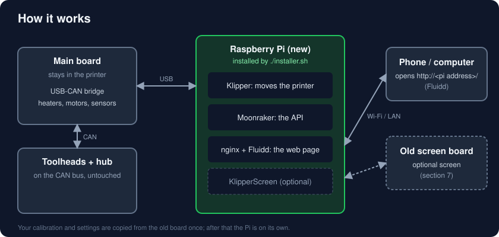

1. The **main board stays in the printer**. It carries the USB-CAN bridge, and the toolheads and filament hub stay on its CAN bus.
2. The **Pi takes over from the screen/host board**: it runs WonderMaker's own Klipper and Moonraker, so the printer behaves as before.
3. **Fluidd** (the web page) is served by nginx on the Pi. Open it from a phone or computer on your network.
4. The installer **copies the software and your settings once** from the original screen board (or from the factory files in this repository). After that the Pi does not need it.
5. An **optional screen** (KlipperScreen on the Pi, or on the original screen board) shows the same ZR Tools pages as the original touchscreen.

## If something goes wrong

| What you see | What to do |
|---|---|
| Fluidd shows `ZRU-B001: Screen–Mainboard communication error` | Expected while the main board is not connected or powered (section 4). |
| Fluidd page shows 403 | `./installer.sh --doctor` and accept the home-folder fix. |
| Fluidd shows "PolKit warnings detected" | `./installer.sh --repair` |
| Screen board: KlipperScreen will not start | A rescue window opens by itself after 3 failed starts. No screen? USB stick with an empty file `WM-FACTORY`, reboot (section 7). |
| Not sure what is wrong | `./installer.sh --doctor`: it explains each problem and offers a fix. |
| Asking someone for help | `./installer.sh --support-bundle` and send the `.tgz`. |

More in [Troubleshooting](#9-troubleshooting).

---

## Contents

- [Quick start](#quick-start) · [Everyday cheat sheet](#everyday-cheat-sheet) · [How it works](#how-it-works) · [If something goes wrong](#if-something-goes-wrong)

Details:

1. [Disclaimer](#disclaimer-use-at-your-own-risk)
2. [Hardware](#2-hardware)
3. [Install](#3-install)
4. [When the main board is connected](#4-when-the-main-board-is-connected)
5. [Fluidd (web panel and ZR Tools)](#5-fluidd-web-panel-and-zr-tools) (including the [OrcaSlicer plugin](#install-the-orcaslicer-plugin-optional-works-without-an-ace-pro))
6. [KlipperScreen on the Raspberry Pi (touchscreen)](#6-klipperscreen-on-the-raspberry-pi-touchscreen)
7. [KlipperScreen on the WonderMaker screen board (optional)](#7-klipperscreen-on-the-wondermaker-screen-board-optional)
8. [Go back / uninstall](#8-go-back--uninstall)
9. [Troubleshooting](#9-troubleshooting)
10. [Repository layout](#10-repository-layout)
11. [Credits and license](#11-credits-and-license)

## Disclaimer (use at your own risk)

This is a community project, not made or supported by WonderMaker. It is provided "as is", without warranty. **It has been tested with a fake home folder, on a fresh Raspberry Pi OS Bookworm Pi (install, `--doctor`, Fluidd, Moonraker, Klipper loading the config) and on one WonderMaker screen board (section 7). It has not been tested with a running printer yet**. Please report what works and what does not.

The installer never flashes any board and never starts Klipper unless you ask for it. You still work on a printer with mains power and heaters: you are responsible for what you connect and run.

## What you get

| | |
|---|---|
| A Pi that takes over from the screen/host board | Raspberry Pi 4 or 5 (64-bit) with Raspberry Pi OS Bookworm |
| WonderMaker's own software, copied from your printer | Klipper and Moonraker forks, your `printer.cfg`, calibration, factory settings |
| Python 3.9 next to Bookworm's 3.11 | needed for WonderMaker's compiled modules |
| Exact package versions of WonderMaker's `klippy-env` and `moonraker-env` | pinned lists in `config/`, read from the factory image |
| Webcams and timelapse | crowsnest and Moonraker timelapse, the versions WonderMaker ships |
| Fluidd with a **Toolheads** panel | four toolheads, chamber, air filter, doors, print with colours, filament mapping |
| Safe without the printer | Moonraker and Fluidd work right away. Without the main board Klipper starts but only reports "cannot connect" (nothing moves); `--no-start` leaves it off until `--first-start` |
| Optional touchscreen | KlipperScreen with a **ZR Tools** page, if you connect a screen to the Pi (**not yet tested on hardware**) |


## 2. Hardware

### 2.1 What you need

- A Raspberry Pi 4 or 5 (64-bit), its official power supply, an SD card of 16 GB or more.
- **Raspberry Pi OS Lite (64-bit), Debian 12 "Bookworm"**, written with Raspberry Pi Imager. Newer Raspberry Pi OS releases are based on Debian 13 "Trixie" and are **not tested**: in the Imager choose **Raspberry Pi OS (other) → Raspberry Pi OS (Legacy, 64-bit) Lite**, which is the Bookworm release. Not the 32-bit image and not the Trixie one. (The Desktop version also works, but Lite is all you need: you use Fluidd in a browser.) In the imager's settings set the **username to `t13dp`** (WonderMaker's software has `/home/t13dp` built in), enable SSH, and set your Wi-Fi or use a cable.
- The printer's **main board** (WM-ZR-D V1.2): it carries the Klipper USB-CAN bridge (USB id `1d50:606f`), and the toolheads and filament hub stay on its CAN bus.
- A **USB-A to JST-XH 2.54 mm 4-pin cable**, bought or made, from the Pi's USB-A port to the red 4-pin connector of the main board. A ready-made one must be **re-pinned** to the board's order (DM, DP, G; leave VIN empty). **VIN is 24 V: cut or do not connect the red wire, never feed it to the Pi.** See [docs/WIRING.md](docs/WIRING.md).
- The WonderMaker software: from **your own printer** (the original screen board, if it is reachable) or the factory files in this repo (see 3.1). 

### 2.2 How it is connected


**Careful:** the red connector's VIN pin carries 24 V. Only DM, DP and G go to the Pi's USB-A plug.

The screen/host board's job (screen, Wi-Fi, running Klipper) moves to the Pi. Step by step with photos: [docs/WIRING.md](docs/WIRING.md). The main board, CAN bus, toolheads and hub are untouched. Details and checks: [docs/HARDWARE.md](docs/HARDWARE.md).

### 2.3 What is not covered

The original touchscreen of the Ultra-S is not replaced one-to-one. Use Fluidd in a browser, or connect a screen to the Pi (see 6, KlipperScreen on the Raspberry Pi).

## 3. Install

Log in to the Pi as `t13dp` and:

```bash
sudo apt-get update
sudo apt-get install -y git
cd ~
git clone https://github.com/ducati1198/wm-ultra-rpi.git
cd wm-ultra-rpi
chmod +x installer.sh
./installer.sh
```

> **"destination path 'wm-ultra-rpi' already exists"?** You already downloaded it once. Do not clone again. Update the folder instead:
>
> ```bash
> cd ~/wm-ultra-rpi
> git pull
> ./installer.sh --update
> ```


### 3.1 The questions

The installer first asks **which printer you have** (ZR Ultra or ZR Ultra-S; or give `--model ultra|ultra-s`) and then **where the WonderMaker software is**:

1. **The original screen board is reachable (SSH). Recommended.** If your WonderMaker screen board starts and is on your network, use this one: the installer fetches `printer_data` (config, calibration, saved variables), `klipper`, `moonraker`, `fluidd` and the factory settings from it, so the Pi gets exactly what your printer ran, with your own settings and the original compiled modules. Find its IP in your router, then `./installer.sh --from-board <IP>`. The default WonderMaker login is user `t13dp`, password `TM88888`. Only `tar` is run there, nothing is written.
2. **Nothing at all: the factory files inside this repository** (`--from-github`). The repo carries the original Klipper and Moonraker (both GPL v3, license included) and the factory settings, with SHA256 checksums that are verified first. There is a folder for each model: [`factory/ultra/`](factory/ultra) and [`factory/ultra-s/`](factory/ultra-s). See [factory/README.md](factory/README.md).

   WonderMaker's **5 compiled modules** (`cs1237`, `hx711`, `heater_air_core`, `heater_feng`, `xy_offset_calibrator_core`: heaters, load cells, calibration) are bundled in the repo too, copied unchanged from an Ultra-S and checked against their factory checksums. They are WonderMaker's binaries (no published license): see the takedown note in [factory/README.md](factory/README.md). `--modules DIR` uses your own copies instead.

### 3.2 What it does

| Step | What and why |
|---|---|
| Checks | user is `t13dp`, 64-bit ARM, enough disk space |
| Model | asks Ultra or Ultra-S and sets `printer.cfg` for it (the Ultra-S includes `zru-s.cfg`: chamber heater, air filter fan, door sensors). This applies to every source; your old `printer.cfg` is saved as `printer.cfg.wm-model-bak` if it had to change |
| Packages | nginx, can-utils, build tools, libraries (apt) |
| Groups | `moonraker-admin`, plus `dialout` and `plugdev` |
| Python 3.9 | installed with `uv` into `~/.pythons` |
| Unpack | `klipper`, `moonraker`, `printer_data`, `fluidd`, factory settings into `~`. Anything already there is moved to `~/wm-rpi-backup/old-<time>/` |
| Environments | `klippy-env` and `moonraker-env` built from `config/klippy-requirements.txt` and `config/moonraker-requirements.txt` (exact versions of WonderMaker's image). The environments themselves are not stored in git: they are machine-built folders, so they are rebuilt on the Pi |
| Module check | tries to import the 10 compiled WonderMaker modules and tells you if one fails |
| Services | `moonraker.service` enabled; `klipper.service` installed but **disabled and stopped** while the install runs (the last step enables and starts it, see 3.3) |
| PolicyKit | installs Moonraker's PolicyKit rule (its own script), so Fluidd can start, stop and restart Klipper, crowsnest and KlipperScreen. Without it Fluidd shows "PolKit warnings detected" |
| nginx | Fluidd on port 80 with the websocket, API and webcam routes. Also lets nginx pass through your home folder (`chmod o+x ~`, Debian 12 makes it private, which gives a 403) |
| CAN rule | brings `can0` up at 1 Mbit when the main board appears |
| Fluidd panel | optional, see 5. The panel is **downloaded from [wm-ultra-fluidd-acepro-panel](https://github.com/ducati1198/wm-ultra-fluidd-acepro-panel) every time** (so you always get its latest), checked against the checksum published next to it. It needs internet (no copy is kept in this repo); if the download fails the web page is skipped with a warning and `--update` retries. `--update` installs a newer panel when there is one |
| Timelapse | `ffmpeg` and `moonraker-timelapse` at a pinned commit (see `config/pins/addons.txt`), downloaded from mainsail-crew on GitHub and checked |
| Webcams | `crowsnest` at a pinned commit (see `config/pins/addons.txt`), installed unattended (builds `ustreamer`); your camera goes in `~/printer_data/config/crowsnest.conf` |

### 3.3 Safety checks

- It never flashes any firmware and never writes to the original screen board.
- At the very end the installer **enables and starts Klipper, Moonraker, nginx and crowsnest**, so everything comes back after a reboot. It first runs the checks (USB bridge, can0, CAN devices, config, modules); a failed check is reported, and Klipper then shows the problem until you fix it. `--no-start` starts nothing; `--first-start` later does the checks and stops without starting if one fails.
- Nothing runs on a schedule and nothing is backed up unless you ask (`--backup`).
- A running print stops `--update`, `--repair`, `--restore`, `--undo` and `--first-start` (override with `--force`).
- It replaces the Fluidd folder only after the zip's checksum matches, keeps your `config.json`, and saves the old Fluidd.
- `--dry-run` goes through everything and changes nothing.

### 3.4 Command table

| Command | What it does |
|---|---|
| `./installer.sh` | install (asks first) |
| `./installer.sh --from-board IP` / `--from-github` | choose the source without being asked |
| `./installer.sh --from-github --model ultra --modules DIR` | use the factory files in this repo; modules from your printer |
| `./installer.sh --check` | report problems, change nothing |
| `./installer.sh --dry-run` | show the plan and what would change |
| `./installer.sh --screen-remove` | removes KlipperScreen from the Pi (Klipper, Moonraker, Fluidd stay) |
| `./installer.sh --first-start` | checks with the main board connected, fixes `canbus_uuid` (asks, keeps a copy), then enables and starts Klipper and the other services |
| `./installer.sh --hw-test` | read-only live test: USB bridge, can0, CAN devices, camera picture, services |
| `./installer.sh --doctor` | finds problems, explains them, offers a fix for each (asks first) |
| `./installer.sh --repair` | puts back services, nginx files, can0 rule, groups; your data is untouched |
| `./installer.sh --update` | after `git pull`: refreshes services, packages, panel, add-ons; shows what changed; keeps `printer_data` |
| `./installer.sh --undo [DIR]` | puts back the folders the installer moved aside (latest by default) |
| `./installer.sh --backup [DIR]` | saves config, calibration and database to a private `.tgz` (only when you run it) |
| `./installer.sh --restore FILE` | restores such a backup after making a safety copy |
| `./installer.sh --support-bundle` | scrubbed logs and config in one `.tgz` for asking for help (passwords, tokens, Wi-Fi, private IPs removed) |
| `./installer.sh --no-start` / `--force` | do not start Klipper at the end / ignore an active print |
| `./installer.sh --disable-klipper` | stop Klipper and disable it |
| `./installer.sh --uninstall` | remove what the installer added to the system |
| `scripts/board_check.sh` | read-only: main board on USB, can0, CAN devices, services, Moonraker |

### 3.5 Open Fluidd

After the install, open `http://<pi address>/`. Without the main board, Klipper starts but cannot reach it, so Fluidd shows an error such as `mcu 'mcu': ZRU-B001: Screen–Mainboard communication error`. That is expected until the main board is connected (section 4).

## 4. When the main board is connected

1. Power the printer, connect the USB cable between Pi and main board (see [docs/WIRING.md](docs/WIRING.md)).
2. Run `./installer.sh --first-start`. It checks the USB bridge (`1d50:606f`), brings `can0` up, asks the CAN bus which devices answer, and compares them with `canbus_uuid` in your config.
3. A **new main board may have a new `canbus_uuid`**. If the bus shows one device the config does not know, the installer offers to put it into `wm_zru_mcu.cfg` (a copy of the old file is kept in `~/wm-rpi-backup/uuid-*`). Toolhead and hub uuids are only reported, never changed.
4. If every check passes it enables and starts Klipper, Moonraker, nginx and crowsnest. If not, the failing checks are listed and nothing is started.
5. Do not run heaters or moves unattended on the first start.

## 5. Fluidd (web panel and ZR Tools)

Fluidd is the web page you use to control the printer from a phone or computer: open `http://<pi address>/` (see 3.5). The installer puts WonderMaker's Fluidd on the Pi, and adds the **Toolheads** panel (and the ACE Pro parts, if you add one). Update it later with `./installer.sh --update`.

**Without an ACE Pro** (the default):

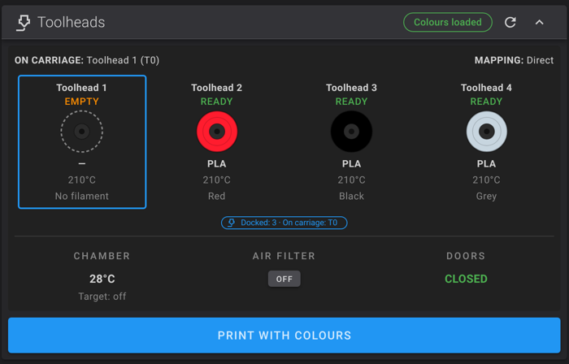

**With an ACE Pro** (the same Fluidd build: the installer downloads the newest panel straight from [wm-ultra-fluidd-acepro-panel](https://github.com/ducati1198/wm-ultra-fluidd-acepro-panel); run that repo's `installer.sh` to add the ACE Pro driver, and the ACE section appears in the Toolheads card):

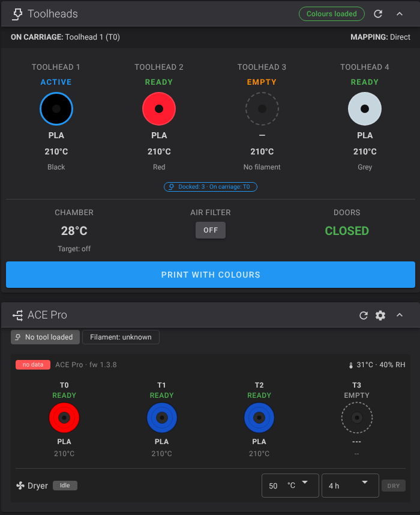

Full dashboard without an ACE Pro:

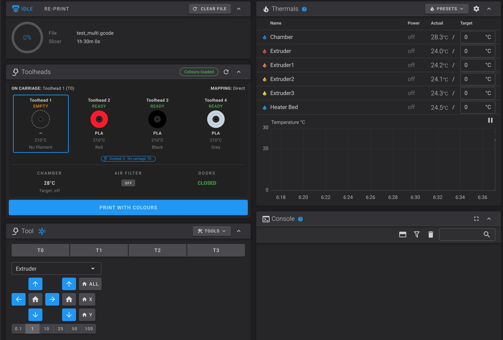


The Fluidd build from [wm-ultra-fluidd-acepro-panel](https://github.com/ducati1198/wm-ultra-fluidd-acepro-panel) adds the Toolheads card (toolhead status, colours and materials, chamber, air filter, doors, **Print with colours**) and the **Choose toolheads** window at print start, shown only when a colour or material does not match.


*Toolhead dialog: colour, material, ACE feeder and the endless-spool chain (demo data).*


*The card shows a progress bar while a tool change runs (demo data).*


Without an Anycubic ACE Pro the ACE parts stay hidden. If you add one later, use [wm-ultra-fluidd-acepro-panel](https://github.com/ducati1198/wm-ultra-fluidd-acepro-panel).

### Install the OrcaSlicer plugin (optional, works without an ACE Pro)

> **Not yet tested in OrcaSlicer or on a printer.** You need OrcaSlicer **2.5 or newer** (it has the plugin system).

The plugin ([WM Toolhead Mapper](https://github.com/ducati1198/wm-ultra-fluidd-acepro-panel/tree/main/orca_plugin), from the [wm-ultra-fluidd-acepro-panel](https://github.com/ducati1198/wm-ultra-fluidd-acepro-panel) repository) lets you pick, inside Orca, which toolhead prints each filament. When you send or export, it writes the choice at the top of the G-code, so the print needs no popup at start. It reads your four toolheads (colour, material, loaded or empty) from the printer, so an ACE Pro is not needed.

**On the Pi (once):** the plugin calls a macro (`WM_SET_TOOL_MAP`) that lives in the panel repository's `wm_stats.cfg`. Install it with that repository's installer, then restart Klipper:

```bash
cd ~
git clone https://github.com/ducati1198/wm-ultra-fluidd-acepro-panel
cd wm-ultra-fluidd-acepro-panel
./installer.sh
```

(Already cloned? `cd ~/wm-ultra-fluidd-acepro-panel && git pull && ./installer.sh --update`.) Say **no** to the ACE Pro question if you have none.

**In OrcaSlicer (once):**

1. Download the plugin file: [`wm_toolhead_mapper.py`](https://raw.githubusercontent.com/ducati1198/wm-ultra-fluidd-acepro-panel/main/orca_plugin/wm_toolhead_mapper.py) (right-click, save as; keep the `.py` name). You can also download it from the [orca_plugin folder of the wm-ultra-fluidd-acepro-panel repository](https://github.com/ducati1198/wm-ultra-fluidd-acepro-panel/tree/main/orca_plugin): open `wm_toolhead_mapper.py` there and use the download button.
2. Open Orca's **Printer settings → Connection** and make sure the host is your Pi's address, for example `192.168.0.50:7125`. The plugin uses it to read the toolheads.
3. Open **File → Plugins**, use the split button **Browse plugins → Install local plugin**, and pick `wm_toolhead_mapper.py`.
4. When Orca asks whether the plugin may connect to your printer, click **Yes**.
5. The plugin brings two parts, **WM Toolheads** (the panel) and **WM Tool Map** (the G-code step). If the Plugins window shows them disabled, enable both.
6. Switch Orca to **Advanced** mode. Open your **Process** settings → **Others** → **Slicing Pipeline Plugin**, add **WM Tool Map**, and save the process preset. Do this for each process preset you print with.
7. Restart Orca. The **WM Toolheads** panel docks on the right of the 3D view.

**Use it:** in the panel, each filament shows its best toolhead (**Auto**: same material, closest colour, each toolhead used once). Change a row to a specific toolhead or **As sliced**, then slice and use **Upload and Print**. If you choose toolheads in Fluidd's **Choose toolheads** window for the same file, the Fluidd choice wins. Full details: [`orca_plugin/INSTALL.md`](https://github.com/ducati1198/wm-ultra-fluidd-acepro-panel/blob/main/orca_plugin/INSTALL.md).

## 6. KlipperScreen on the Raspberry Pi (touchscreen)

Use this if you connect a touchscreen directly to the Raspberry Pi. KlipperScreen runs on the Pi next to Klipper and Moonraker, with the ZR Tools panel. For the original WonderMaker screen board as the screen, see section 7 instead.

> **Not yet tested on hardware.** It was built against the KlipperScreen documentation and checked with automated tests, but nobody has run it on a Pi with a screen yet. Please report what you see.

The installer asks **"Add a touchscreen?"** (default yes). Skip it with `--screen off`. Options:

| Option | Meaning |
|---|---|
| `--screen on\|off\|macros` | `on`: KlipperScreen on the Pi (for a screen plugged into the Pi). `off`: nothing. `macros`: only the ZR Tools macros in `printer.cfg`, for people who use the WonderMaker screen board (section 7) |
| `--screen-layout tabs\|grid` | `tabs` (default): big touch buttons with bottom tabs. `grid`: cards on a home page |
| `--screen-backend x11\|weston\|cage` | graphics stack, default `x11` |
| `--screen-test` | read-only: shows the screen and touch device found |

What it does: installs [KlipperScreen](https://github.com/KlipperScreen/KlipperScreen) pinned to one tested commit (`34610ce`, so a later upstream change cannot break it), copies the ZR Tools panel into it, adds the helper macros (`zr_tools.cfg`) to `printer.cfg` and enables the `KlipperScreen` service. KlipperScreen's own home screen and menus stay as they are; ZR Tools is one extra menu entry.

The screen is detected for you: size from the video output (800x480 and smaller screens use compact buttons, 1024x600 and larger use comfortable ones) and the touch device through udev. On a 5 inch and a 7 inch screen both layouts work.

**ZR Tools pages:** Toolheads (select, heat, load, unload, purge, colour, material), Filament, Climate (chamber, air filter), Calibrate (only the macros that exist on your printer: Z and XY offsets, bed mesh, PID, wipe position, input shaper via the accelerometer), **ACE Pro** (only when an ACE Pro is present: slots, load/unload, feed assist, dryer presets, endless spool), More (collision detection settings, **read-only**; timelapse; restart; system page with Pi temperature, power flags, can0, Klipper state and a backup button) and Settings. Fan, Z offset, pressure advance and camera use KlipperScreen's own pages. The emergency stop is KlipperScreen's own button, shown while printing.

**Settings page:** layout (tabs/grid), density (auto/compact/comfortable) and light/dark theme. They are stored in `~/printer_data/config/zr_screen.conf` (not in KlipperScreen's own settings). You can also change the layout with `./installer.sh --screen-layout grid`.

**What it looks like** (real captures from the WonderMaker screen board, 800x480, layout `tabs`, with demo data: temperatures, colours and ACE slots are made up):

| | |
|---|---|
| 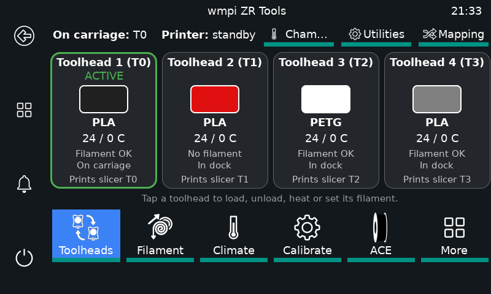 | 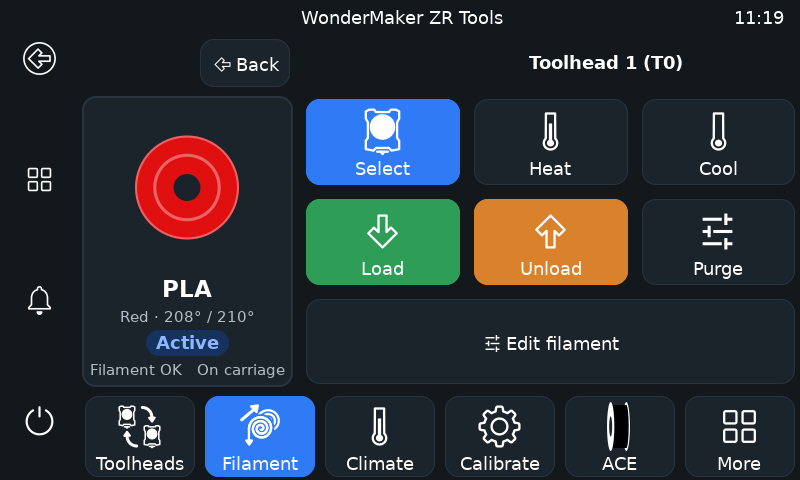 |
| Toolheads: colour, material, temperature and which slicer tool prints on each head | Filament: select, heat, load, unload and purge one head |
| 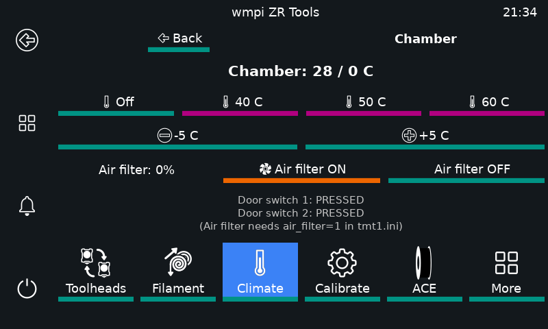 | 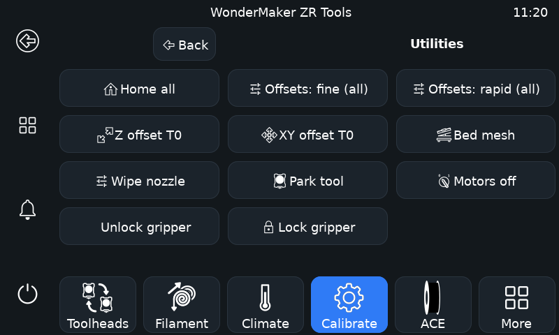 |
| Climate: chamber, air filter, doors | Utilities: home, offsets, wipe, park, motors off |
| 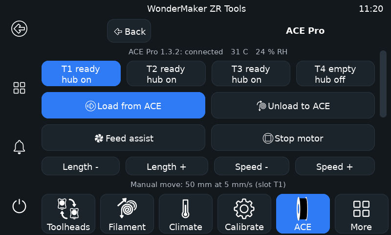 | 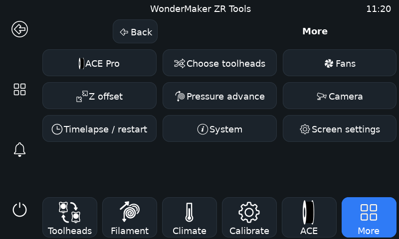 |
| ACE Pro page (only shown when an ACE Pro is present) | More: ACE Pro, fans, pressure advance, camera, system, screen settings |
| 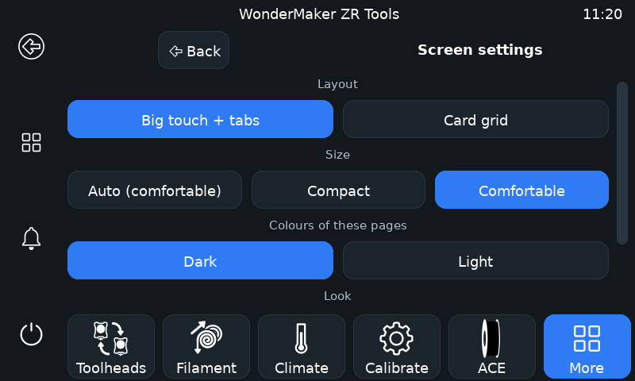 | 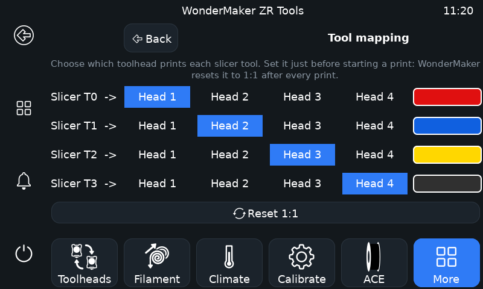 |
| Screen settings: layout, size, colours | Tool mapping: which head prints each slicer tool |

The `grid` layout shows the same pages as cards instead of tabs; it has not been photographed yet.

**Rotation** is an operating-system setting, not a ZR Tools one. On X11 use `xrandr --output <name> --rotate left` (and a matching touch matrix); for Weston, `transform=90` in `weston.ini`. See the KlipperScreen documentation.

`--update`, `--repair` and `--doctor` copy the panel files back if a KlipperScreen update removed them. Using the original WonderMaker screen board as the KlipperScreen is section 7.

## 7. KlipperScreen on the WonderMaker screen board (optional)

> **Tested on one screen board (Nov 2026):** the install from GitHub, the display and touch work. The Wi-Fi page, the Pi address page and the full printing workflow still need more testing. The board's kernel has no virtual console (`/dev/tty0`), so the installer runs X on its own seat (display, framebuffer and touch assigned to `seat1`) with a custom service.

Instead of buying a screen for the Pi, the original screen board can run KlipperScreen and talk to the Pi's Klipper/Moonraker over the network. The Pi is never checked or contacted by the install; KlipperScreen connects once the Pi is running. The screen board only shows the screen: every button on the ZR Tools page (Save filament, Load, Unload, Purge, Chamber, Mapping) sends a command to a helper macro such as `ZR_SET_TOOL_INFO` or `ZR_LOAD`, and those macros must exist on the **Pi**, in `zr_tools.cfg`, which `printer.cfg` has to include. Without them those buttons do nothing (heating and moving still work). On the Pi, run `./installer.sh --screen macros` to add only the macros, which is all you need when the screen board is your only screen (the installer also offers this when you answer no to "Add a touchscreen?"). `./installer.sh --screen on` adds the macros too, but also installs a KlipperScreen on the Pi itself, which is only useful if you plug a screen into the Pi; you can remove that one later with `./installer.sh --screen-remove` (the macros stay).

**Before you start: fix the board's clock and apt (other users need this).** On a factory screen board `sudo apt-get update` fails (Debian 11 was moved to an archive and the clock is often wrong), so even `sudo apt-get install -y git` fails. The script repairs apt itself, but if you want to do it by hand, or the script says apt fails, run this on the board:

```bash
# 1. Set the date and time (HTTPS to GitHub fails if the clock is wrong). Use your own date/time, UTC:
date                                   # check it first
sudo date -s "2026-11-03 18:00:00"     # example only: put today's date and time here
# 2. Point apt at the Debian archive and stop it rejecting old package lists
sudo cp /etc/apt/sources.list /etc/apt/sources.list.orig
sudo sed -i -E 's#https?://[^ /]+/debian-security#http://archive.debian.org/debian-security#; t; s#https?://[^ /]+/debian/?#http://archive.debian.org/debian/#' /etc/apt/sources.list
printf 'Acquire::Check-Valid-Until "false";\nAcquire::Check-Date "false";\n' | sudo tee /etc/apt/apt.conf.d/99no-check-valid-until
# 3. Now this works
sudo apt-get update
sudo apt-get install -y git
```

Never run `apt upgrade` or `apt full-upgrade` on this board: it can replace WonderMaker's held X server and break the screen. The script only uses `apt-get install --no-upgrade`.

Then on the **screen board** (SSH in as `t13dp`, it needs internet). Pick one way to get the files:

**Option A: no git needed** (works even if apt is broken)

```bash
cd ~
curl -fsSL https://codeload.github.com/ducati1198/wm-ultra-rpi/tar.gz/refs/heads/main | tar xz && cd wm-ultra-rpi-main
```

**Option B: with git** (after the clock and apt fix above, so `apt-get install -y git` works)

```bash
cd ~
git clone https://github.com/ducati1198/wm-ultra-rpi && cd wm-ultra-rpi
```

If you cloned it before, a `git clone` copy does **not** update by itself: run `cd wm-ultra-rpi && git pull` first (or delete the folder and clone again). With Option A, delete the old `wm-ultra-rpi-main` folder before downloading again.

Then, inside the folder you just downloaded (you are already in it after Option A or B), run:

```bash
bash scripts/screen_board.sh --dry-run     # shows every change, changes nothing (it asks for the Pi's IP address)
bash scripts/screen_board.sh               # asks for your Pi's IP address, then installs
```

**To uninstall KlipperScreen and go back to the factory screen** (over SSH, as `t13dp`):

```bash
bash ~/wm-screen-backup/screen_board.sh --factory-restore
```

It removes KlipperScreen, turns the factory services back on exactly as they were, and reboots the board. Nothing is deleted.

The script asks for your Pi's IP address. You can also give it with `--pi <address>`. To change it later, tap **Pi address** (on the start screen while the Pi cannot be reached, or in the More menu), or run `bash scripts/screen_board.sh --set-pi <address>`. The Pi does not have to be running during the install.

What it does, in this order (everything that can fail comes before the factory app is stopped):

1. Checks: nothing is printing, disk space, apt works, GitHub reachable. If a check fails nothing is changed.
2. Debian 11 is archived, so apt is pointed at `archive.debian.org` with the date checks off (the same fix as on the original board). It only runs `apt-get install --no-upgrade`, **never `apt upgrade`**.
3. Installs the X11 and KlipperScreen packages (and a Wi-Fi page that uses the board's own `wpa_supplicant`, because the stock KlipperScreen Network page needs NetworkManager, which this board does not use: scan, tap a network, type the password; nothing is saved unless the connection works), KlipperScreen at the pinned commit, and ZR Tools. WonderMaker's own held X server is kept; its matching `xserver-xorg-legacy` is taken from `/packages/xserver` on the board.
4. Stops and **disables** (deletes nothing) `makerbase-client` (the factory screen app), klipper, moonraker, nginx, crowsnest, makerbase-webcam, janus, klipper-mcu and hostapd, and obico/octoapp if you installed them. The previous state is saved in `~/wm-screen-backup/disabled.list`.
5. Starts KlipperScreen with the Rockchip modesetting driver; if X does not start it switches to the plain framebuffer (`fbdev`) driver by itself (`--screen-driver fbdev` forces it).

**What you need before you start:** the screen board powered, on your network (it keeps using its own Wi-Fi settings) and reachable over SSH as `t13dp` (default password in WonderMaker's image); about 1.5 GB free disk (the install needs it); and your Pi's IP address. The install takes about 20 minutes (the Python packages are built on the board).

**On the screen after the install**

- The ZR Tools tile is in the main menu. If the Pi cannot be reached, the start screen shows **Network**, **Pi address** and the usual buttons.
- **Network** is the Wi-Fi page: it shows the current network and IP, **Scan again** lists the networks, tap one, type the password on the on-screen keyboard. If the connection fails it goes back to the previous network.
- **Pi address** changes the Pi's IP address (also under More). It saves and restarts KlipperScreen.
- The Pi's `moonraker.conf` must trust the board's address (`trusted_clients`), otherwise the Pi refuses the connection.
- The board has 487 MB of RAM and no swap, so do not run other heavy programs on it.

**Go back to the factory software** (any of these, nothing is lost):

| How | What happens |
|---|---|
| On the screen: **ZR Tools > More > System > Factory mode** | asks to confirm, then does the same as the command below |
| `bash ~/wm-screen-backup/screen_board.sh --factory-restore` | removes KlipperScreen, re-enables exactly the services that were enabled before, reboots |
| `bash scripts/screen_board.sh --uninstall-klipperscreen` | same as `--factory-restore`: KlipperScreen is never removed without turning the factory services back on |
| `bash scripts/screen_board.sh --status` | read-only: what is enabled, running and installed |

**If KlipperScreen stops working: the rescue tool** (installed by default, `--no-rescue` skips it; *not yet tested on hardware*)

| Situation | What happens |
|---|---|
| KlipperScreen fails to start 3 times within 2 minutes | The board stops retrying and opens a **rescue window** with big touch buttons: **Restart KlipperScreen**, **Factory restore** (asks to confirm first), **Reboot board**, and **More**: error details, network status, reset KlipperScreen settings, reinstall KlipperScreen files. |
| The window is wanted on purpose | **ZR Tools > More > System > Rescue**, or a USB stick (below). KlipperScreen stops while it is open; **Restart KlipperScreen** brings it back. |
| No network, no working screen app | Use a USB stick: plug a FAT32 or exFAT stick into the board and create an **empty file** on it named `WM-FACTORY` (go back to the factory software, no questions asked) or `WM-RESCUE` (open the rescue window), then **reboot the board**. The stick is checked once, at boot. |

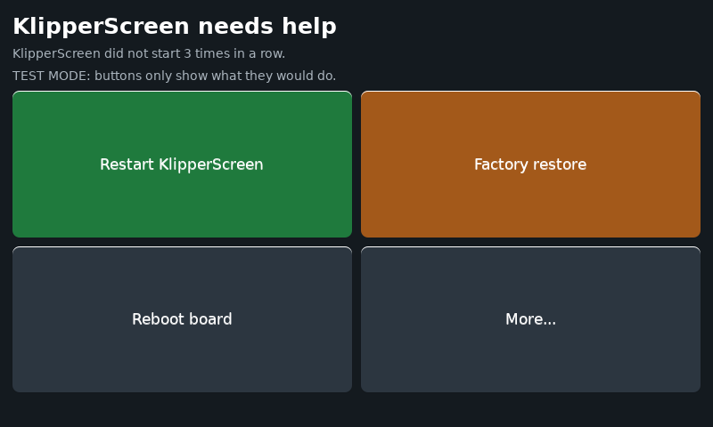
*The rescue window (800x480). Drawn on the screen board in test mode.*

Details:
- **Factory restore** never leaves the board stuck. It uses the saved list `~/wm-screen-backup/disabled.list`. If that file is missing, it uses a built-in list of the 8 factory services (`makerbase-client`, `klipper`, `moonraker`, `nginx`, `crowsnest`, `makerbase-webcam`, `klipper-mcu`, `hostapd`, each in the state a factory board has). `klipper` and `hostapd` are not enabled on a factory board; the WonderMaker app is expected to start Klipper itself (to be confirmed on hardware).
- Before any restore your KlipperScreen settings and the Pi address are copied to `~/wm-screen-backup/rescue-snapshots/`.
- The USB flag file is renamed to `WM-FACTORY.done` (or `WM-RESCUE.done`) after it is used, so a stick left in does not trigger it again. A short report, `WM-RESCUE-LOG.txt`, is written to the stick. The USB check works only while KlipperScreen is installed (the factory restore removes the rescue tool).
- If the screen server itself cannot start, the window tries a second graphics driver; if that fails too, a message is drawn straight on the screen and the USB stick is the way out (best effort).
- Not covered: a KlipperScreen that is running but frozen or black (a stick with `WM-RESCUE` or `WM-FACTORY` still works).
- Files: `screen_rescue/wm-screen-rescue`, `screen_rescue/wm-rescue-window.py`; log in `/var/log/wm-screen-rescue.log`.
- To test it safely: first check that a stick shows up (`lsblk` over SSH), then try `WM-RESCUE`, then break KlipperScreen on purpose (for example rename `/usr/local/sbin/wm-ks-start` and reboot) and watch the window appear, then try **Factory restore** and `WM-FACTORY` last.

To read the board first (nothing is changed): `scripts/screen_board_inspect.sh`. Notes: the board's Reboot/Shut down buttons in ZR Tools act on the **Pi**; the Pi's `moonraker.conf` must trust the board's address; the apt packages stay installed after a restore.

On the Pi, `./installer.sh --screen-remove` removes KlipperScreen again (Klipper, Moonraker and Fluidd stay).

## 8. Go back / uninstall

- `./installer.sh --uninstall` removes the services, nginx files and can0 rule the installer added. Your folders in `~` stay.
- Moved folders are in `~/wm-rpi-backup/`.
- Nothing was changed on the original screen board or on any firmware, so there is nothing to restore there.

## 9. Troubleshooting

| Problem | What to try |
|---|---|
| "you are user ..., expected t13dp" | Create the card again with username `t13dp`. WonderMaker's paths are fixed to `/home/t13dp`. |
| Can't read the original screen board | Check IP, power and the password. Or use the factory files (`--from-github`). |
| A compiled module "does not import" | Python must be 3.9 and the CPU 64-bit ARM. Check: `cd ~/klipper/klippy && ~/klippy-env/bin/python -c "import sys; sys.path.insert(0, '.'); import extras.cs1237"` (no output means it works; importing from inside the `extras` folder gives a false error) |
| Fluidd blank / old page | Hard-refresh (Ctrl/Cmd+Shift+R). Check `sudo nginx -t` and `systemctl status nginx`. |
| No picture from the camera | `ls /dev/v4l/by-id/`, put that path on the `device:` line of `~/printer_data/config/crowsnest.conf`, `sudo systemctl restart crowsnest` |
| Moonraker does not answer | `journalctl -u moonraker -n 50` |
| Fluidd page shows 403 Forbidden | nginx cannot read your home folder (Debian 12 makes it private). `chmod o+x ~ && sudo systemctl reload nginx`, or `./installer.sh --doctor` and accept the fix. |
| Fluidd says "PolKit warnings detected" | Moonraker lacks its PolicyKit rule: `./installer.sh --repair` installs it. |
| Fluidd says `mcu 'mcu': ZRU-B001: Screen–Mainboard communication error` | Expected while the main board is not connected: Klipper cannot reach it over CAN. Connect it (section 4). |
| No `can0` | Main board not powered or not on USB. `lsusb` should show `1d50:606f`. |
| Klipper "mcu ... uuid" error | New board, new `canbus_uuid` (see 4). |
| Screen board: `apt-get update` fails | Fix the clock and apt first (the block at the start of section 7). |
| Screen board: KlipperScreen says it cannot connect | Open **Pi address** on the screen and enter the Pi's IP; check the Pi is on and trusts the board in `moonraker.conf`. |
| Screen board: black or wrong screen | `bash ~/wm-screen-backup/screen_board.sh --factory-restore` from SSH, or `--screen-driver fbdev` when installing. With no network: the rescue window (opens after 3 failed starts) or a USB stick with an empty file `WM-FACTORY` (section 7). |

## 10. Repository layout

```
installer.sh            the Pi installer
factory/ultra/          WonderMaker ZR Ultra: Klipper, Moonraker, settings, scripts, checksums
factory/ultra-s/        WonderMaker ZR Ultra-S: same, with the chamber/air-filter/door settings on
screen_rescue/          rescue window and USB-stick check for the screen board
scripts/                pull_from_board.sh, stage_from_repo.sh, board_check.sh, screen_board.sh (+ _inspect, _precheck, _preflight_mac) for the screen board
config/                 systemd units, nginx files, can0 udev rule, pinned Python requirements, crowsnest template, addon version pins
zr_tools/               ZR Tools KlipperScreen panel (copied by the installer)
docs/                   HARDWARE.md, WIRING.md and images
tests/                  run_tests.sh (installer, fake home) and test_screen.py (ZR Tools panel)
```

`factory/` holds WonderMaker's Klipper and Moonraker (GPL), the factory settings, helper scripts, and their compiled modules and MCU firmware (WonderMaker's binaries, see [factory/README.md](factory/README.md)). Your own calibration is not in the repository.

## 11. Credits and license

Klipper, Moonraker and Fluidd are their own projects and licenses. The Anycubic ACE Pro and WonderMaker are trademarks of their owners; this project is unaffiliated. Layout inspired by [acepro-any-klipper](https://github.com/ducati1198/acepro-any-klipper). The Fluidd Toolheads card, the ACE Pro driver config and the OrcaSlicer plugin live in [wm-ultra-fluidd-acepro-panel](https://github.com/ducati1198/wm-ultra-fluidd-acepro-panel) ([plugin](https://github.com/ducati1198/wm-ultra-fluidd-acepro-panel/tree/main/orca_plugin)). This repository is under the GPL v3, see [LICENSE](LICENSE).
