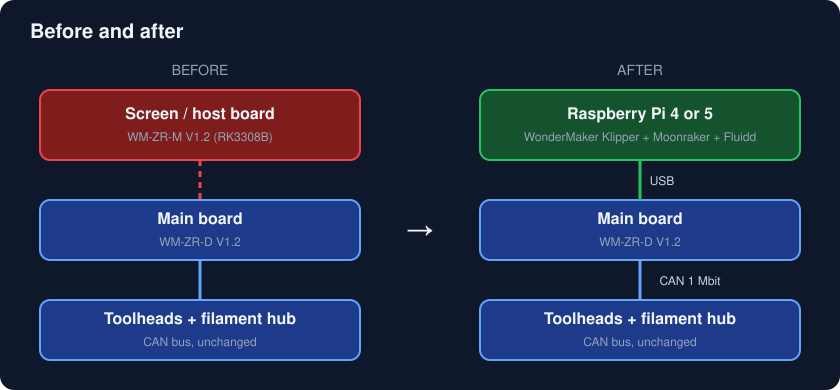
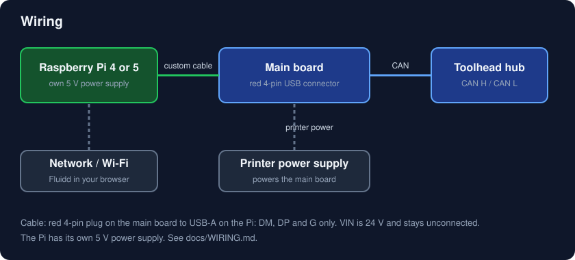
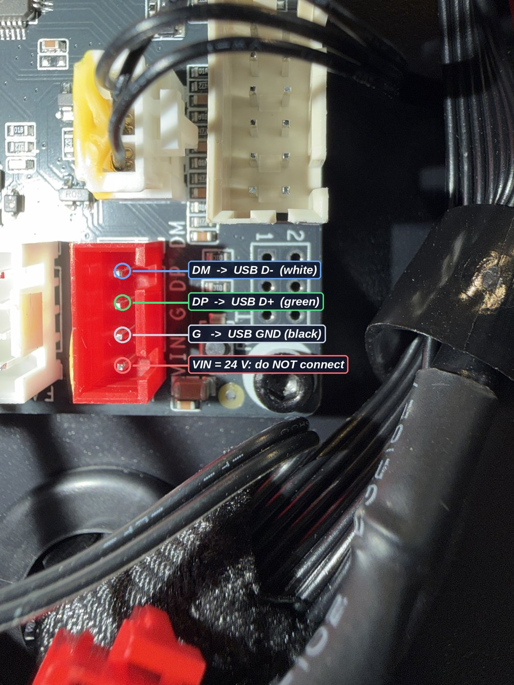
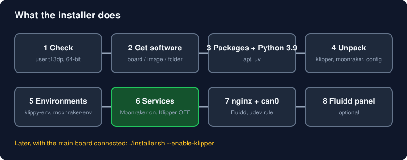
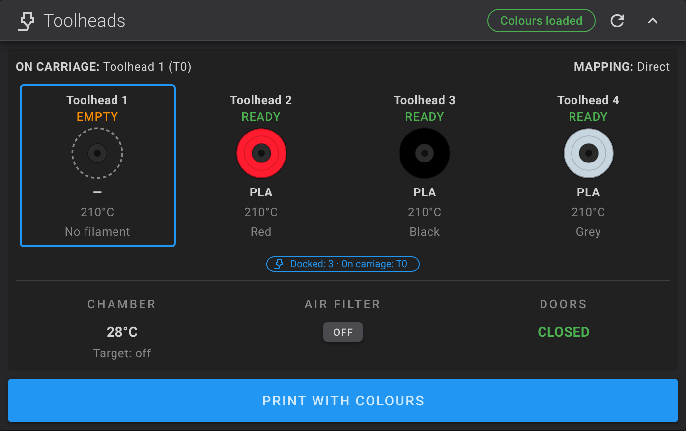
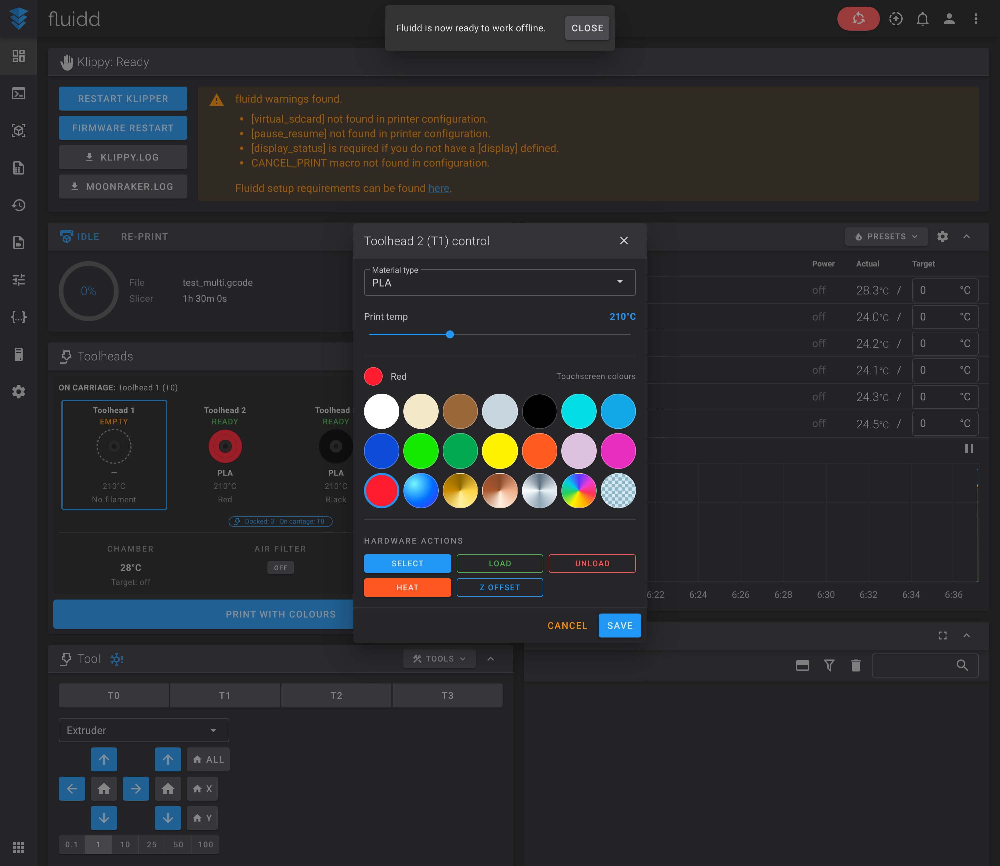

<div align="center">

# WonderMaker ZR Ultra / Ultra-S: Raspberry Pi replacement

**Replace screen/host board with a Raspberry Pi running WonderMaker's own Klipper, Moonraker and Fluidd.**

[](LICENSE) 

</div>

## Contents

1. [Disclaimer](#disclaimer-use-at-your-own-risk)
2. [Hardware](#2-hardware)
3. [Install](#3-install)
4. [When the main board is connected](#4-when-the-main-board-is-connected)
5. [Fluidd panel and ZR Tools](#5-fluidd-panel-and-zr-tools)
6. [Go back / uninstall](#6-go-back--uninstall)
7. [Troubleshooting](#7-troubleshooting)
8. [Repository layout](#8-repository-layout)
9. [Credits and license](#9-credits-and-license)

## Disclaimer (use at your own risk)

This is a community project, not made or supported by WonderMaker. It is provided "as is", without warranty. **It has been tested only with a fake home folder and a synthetic disk image, not yet on a real printer**: the author is waiting for a replacement main board. Please report what works and what does not.

The installer never flashes any board and never starts Klipper unless you ask for it. You still work on a printer with mains power and heaters: you are responsible for what you connect and run.

## What you get

| | |
|---|---|
| A Pi that replaces the dead screen/host board | Raspberry Pi 400 (or any 64-bit Pi 4/5 class) with Raspberry Pi OS Bookworm |
| WonderMaker's own software, copied from your printer | Klipper and Moonraker forks, your `printer.cfg`, calibration, factory settings |
| Python 3.9 next to Bookworm's 3.11 | needed for WonderMaker's compiled modules |
| Exact package versions of WonderMaker's `klippy-env` and `moonraker-env` | pinned lists in `config/`, read from the factory image |
| Webcams and timelapse | crowsnest and Moonraker timelapse, the versions WonderMaker ships |
| Fluidd with a **Toolheads** panel | four toolheads, chamber, air filter, doors, print with colours, filament mapping |
| Safe by default | Moonraker and Fluidd work right away, **Klipper stays off** until you connect the main board |
| Optional ZR Tools | KlipperScreen panel if you add a touchscreen to the Pi |



## 2. Hardware

### 2.1 What you need

- A Raspberry Pi 400 or another 64-bit Pi (4 or 5), its power supply, an SD card of 16 GB or more.
- Raspberry Pi OS **Bookworm 64-bit**, written with Raspberry Pi Imager. In the imager's settings set the **username to `t13dp`** (WonderMaker's software has `/home/t13dp` built in), enable SSH, and set your Wi-Fi or use a cable.
- The **replacement main board** (WM-ZR-D V1.2): it carries the Klipper USB-CAN bridge (USB id `1d50:606f`), and the toolheads and filament hub stay on its CAN bus.
- A **custom cable** from the Pi's USB-A port to the red 4-pin connector of the main board (DM, DP, G only; its VIN pin is 24 V). See [docs/WIRING.md](docs/WIRING.md).
- The WonderMaker software: from **your own printer** (reachable old board, a disk image, or a folder made earlier) or the factory files in this repo (see 3.1). 

### 2.2 How it is connected





**Careful:** the red connector's VIN pin carries 24 V. Only DM, DP and G go to the Pi's USB-A plug.

The old board's job (screen, Wi-Fi, running Klipper) moves to the Pi. Step by step with photos: [docs/WIRING.md](docs/WIRING.md). The main board, CAN bus, toolheads and hub are untouched. Details and checks: [docs/HARDWARE.md](docs/HARDWARE.md).

### 2.3 What is not covered

The touchscreen of the Ultra-S is not replaced by this repo. Use Fluidd in a browser, or add a KlipperScreen touchscreen to the Pi (see ZR Tools).

## 3. Install

Log in to the Pi as `t13dp` and:

```
git clone https://github.com/ducati1198/wm-ultra-rpi.git
cd wm-ultra-rpi
./installer.sh
```



### 3.1 The questions

The installer first asks **which printer you have** (ZR Ultra or ZR Ultra-S; or give `--model ultra|ultra-s`) and then **where the WonderMaker software is**:

1. **The old board is still reachable (SSH).** Give its IP. The default WonderMaker login is user `t13dp`, password `TM88888`. Only `tar` is run there, nothing is written.
2. **A disk image of its card or eMMC** (`.img` or `.img.gz`). Needs `e2fsprogs` and free space about the unpacked image (about 8 GB for the Ultra-S image). No printer needed.
3. **A stage folder** (`klipper.tgz`, `moonraker.tgz`, `data.tgz`) made by `scripts/pull_from_board.sh` or `scripts/extract_from_image.sh`.
4. **Nothing at all: the factory files inside this repository** (`--from-github`). The repo carries the original Klipper and Moonraker (both GPL v3, license included) and the factory settings, with SHA256 checksums that are verified first. There is a folder for each model: [`factory/ultra/`](factory/ultra) and [`factory/ultra-s/`](factory/ultra-s). See [factory/README.md](factory/README.md).

   WonderMaker's **5 compiled modules** (`cs1237`, `hx711`, `heater_air_core`, `heater_feng`, `xy_offset_calibrator_core`: heaters, load cells, calibration) are bundled in the repo too, copied unchanged from an Ultra-S and checked against their factory checksums. They are WonderMaker's binaries (no published license): see the takedown note in [factory/README.md](factory/README.md). `--modules DIR` uses your own copies instead.

### 3.2 What it does

| Step | What and why |
|---|---|
| Checks | user is `t13dp`, 64-bit ARM, enough disk space |
| Model | asks Ultra or Ultra-S and sets `printer.cfg` for it (the Ultra-S includes `zru-s.cfg`: chamber heater, air filter fan, door sensors). This applies to every source; your old `printer.cfg` is saved as `printer.cfg.wm-model-bak` if it had to change |
| Packages | nginx, can-utils, build tools, libraries (apt) |
| Groups | `moonraker-admin`, plus `dialout` and `plugdev` |
| Python 3.9 | installed with `uv` into `~/.pythons` |
| Unpack | `klipper`, `moonraker`, `printer_data`, `fluidd`, factory settings into `~`. Anything already there is moved to `~/wm-rpi-backup/old-<time>/` |
| Environments | `klippy-env` and `moonraker-env` built from `config/klippy-requirements.txt` and `config/moonraker-requirements.txt` (exact versions of WonderMaker's image). The environments themselves are not stored in git: they are machine-built folders, so they are rebuilt on the Pi |
| Module check | tries to import the 10 compiled WonderMaker modules and tells you if one fails |
| Services | `moonraker.service` enabled; `klipper.service` installed but **disabled and stopped** |
| nginx | Fluidd on port 80 with the websocket, API and webcam routes |
| CAN rule | brings `can0` up at 1 Mbit when the main board appears |
| Fluidd panel / ZR Tools | optional, see 5 |
| Timelapse | `ffmpeg` and `moonraker-timelapse` (latest release; it is the same version WonderMaker ships), downloaded from mainsail-crew on GitHub |
| Webcams | `crowsnest` v5.0.12 (latest release; WonderMaker ships a 2023 version), installed unattended (builds `ustreamer`); your camera goes in `~/printer_data/config/crowsnest.conf` |

### 3.3 Safety checks

- It never flashes any firmware and never writes to the old board.
- It never starts Klipper. Only `./installer.sh --enable-klipper` does, after asking.
- It replaces the Fluidd folder only after the zip's checksum matches, keeps your `config.json`, and saves the old Fluidd.
- `--dry-run` goes through everything and changes nothing.

### 3.4 Command table

| Command | What it does |
|---|---|
| `./installer.sh` | install (asks first) |
| `./installer.sh --from-board IP` / `--from-image FILE` / `--from-stage DIR` | choose the source without being asked |
| `./installer.sh --from-github --model ultra --modules DIR` | use the factory files in this repo; modules from your printer |
| `./installer.sh --check` | report problems, change nothing |
| `./installer.sh --dry-run` | show what would change |
| `./installer.sh --enable-klipper` | start Klipper and enable it at boot (asks first) |
| `./installer.sh --disable-klipper` | stop Klipper and disable it |
| `./installer.sh --uninstall` | remove what the installer added to the system |
| `scripts/board_check.sh` | read-only: main board on USB, can0, CAN devices, services, Moonraker |

### 3.5 Open Fluidd

After the install, open `http://<pi address>/`. Fluidd shows "Klippy disconnected" until Klipper runs. That is expected.

## 4. When the main board is connected

1. Power the printer, connect the USB cable between Pi and main board.
2. Run `scripts/board_check.sh`. You want `1d50:606f` on USB and `can0` up.
3. With Klipper still stopped the script lists devices on the CAN bus. A **new main board has a new `canbus_uuid`**: put it in the `[mcu]` section of your config (`~/printer_data/config/`, look for `canbus_uuid`). Save a copy of the file first.
4. `./installer.sh --enable-klipper`. Watch `journalctl -u klipper -f`.
5. Do not run heaters or moves unattended on the first start.

## 5. Fluidd panel and ZR Tools



The Fluidd build in [fluidd/](fluidd/) adds the Toolheads card (toolhead status, colours and materials, chamber, air filter, doors, **Print with colours**) and the **Choose toolheads** window at print start, shown only when a colour or material does not match.




Without an Anycubic ACE Pro the ACE parts stay hidden. If you add one later, use [wm-ultra-fluidd-acepro-panel](https://github.com/ducati1198/wm-ultra-fluidd-acepro-panel).

**ZR Tools** (`zr_tools/`) is a KlipperScreen panel with tool, chamber and air-filter pages. The installer only copies it to `~/zr_tools`; run `bash install_zr_tools.sh` there once Klipper is running (it restarts Klipper).

## 6. Go back / uninstall

- `./installer.sh --uninstall` removes the services, nginx files and can0 rule the installer added. Your folders in `~` stay.
- Moved folders are in `~/wm-rpi-backup/`.
- Nothing was changed on the old board or on any firmware, so there is nothing to restore there.

## 7. Troubleshooting

| Problem | What to try |
|---|---|
| "you are user ..., expected t13dp" | Create the card again with username `t13dp`. WonderMaker's paths are fixed to `/home/t13dp`. |
| Can't read the old board | Check IP, power and the password. Or use an image (`--from-image`). |
| A compiled module "does not import" | Python must be 3.9 and the CPU 64-bit ARM. Check: `cd ~/klipper/klippy/extras && ~/klippy-env/bin/python -c 'import cs1237'` |
| Fluidd blank / old page | Hard-refresh (Ctrl/Cmd+Shift+R). Check `sudo nginx -t` and `systemctl status nginx`. |
| No picture from the camera | `ls /dev/v4l/by-id/`, put that path on the `device:` line of `~/printer_data/config/crowsnest.conf`, `sudo systemctl restart crowsnest` |
| Moonraker does not answer | `journalctl -u moonraker -n 50` |
| No `can0` | Main board not powered or not on USB. `lsusb` should show `1d50:606f`. |
| Klipper "mcu ... uuid" error | New board, new `canbus_uuid` (see 4). |

## 8. Repository layout

```
installer.sh            the Pi installer
factory/ultra/          WonderMaker ZR Ultra: Klipper, Moonraker, settings, scripts, checksums
factory/ultra-s/        WonderMaker ZR Ultra-S: same, with the chamber/air-filter/door settings on
scripts/                pull_from_board.sh, extract_from_image.sh, stage_from_repo.sh, board_check.sh
config/                 systemd units, nginx files, can0 udev rule, pinned Python requirements, crowsnest template, addon version pins
fluidd/                 Fluidd v1.37.7 with the Toolheads panel (zip, checksum, patch)
zr_tools/               optional KlipperScreen panel
docs/                   HARDWARE.md and images
tests/run_tests.sh      tests (fake home, synthetic disk image)
```

`factory/` holds WonderMaker's Klipper and Moonraker (GPL), the factory settings, helper scripts, and their compiled modules and MCU firmware (WonderMaker's binaries, see [factory/README.md](factory/README.md)). Your own calibration is not in the repository.

## 9. Credits and license

Klipper, Moonraker and Fluidd are their own projects and licenses. The Anycubic ACE Pro and WonderMaker are trademarks of their owners; this project is unaffiliated. Layout inspired by [acepro-any-klipper](https://github.com/ducati1198/acepro-any-klipper). This repository is under the GPL v3, see [LICENSE](LICENSE).
