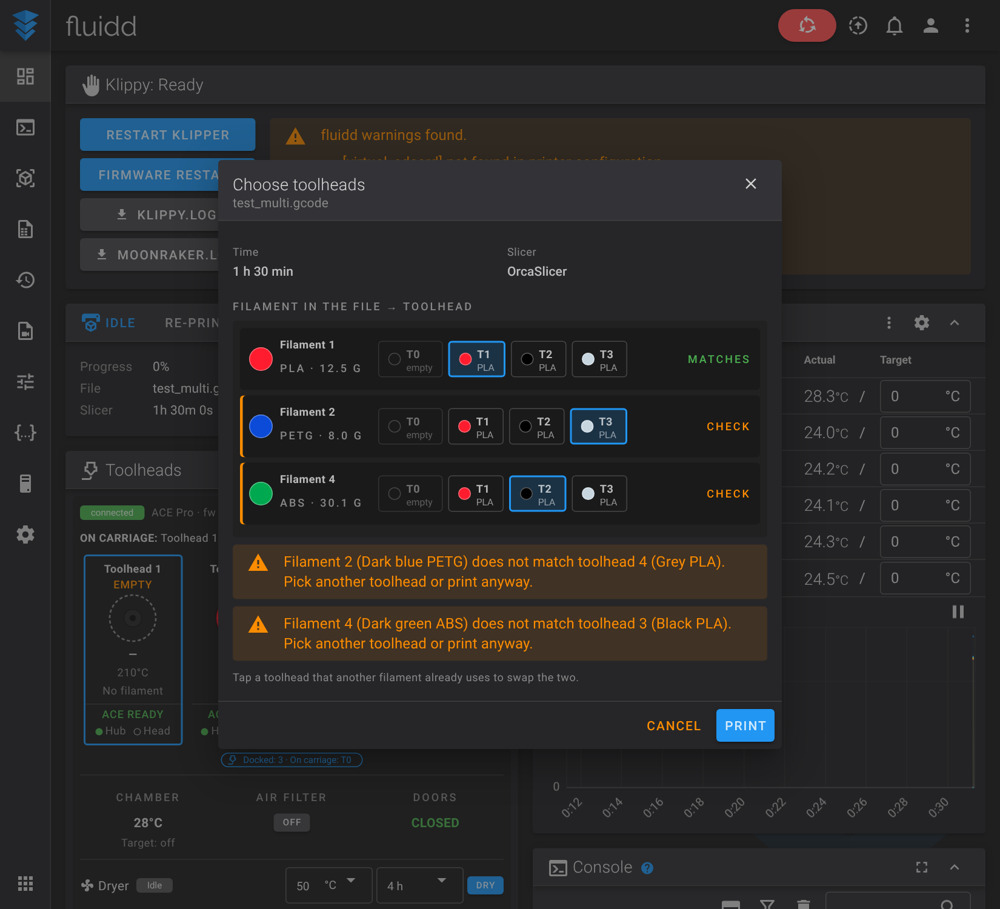
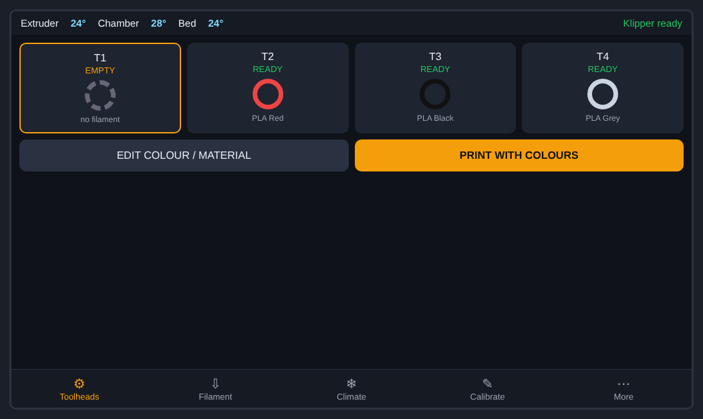
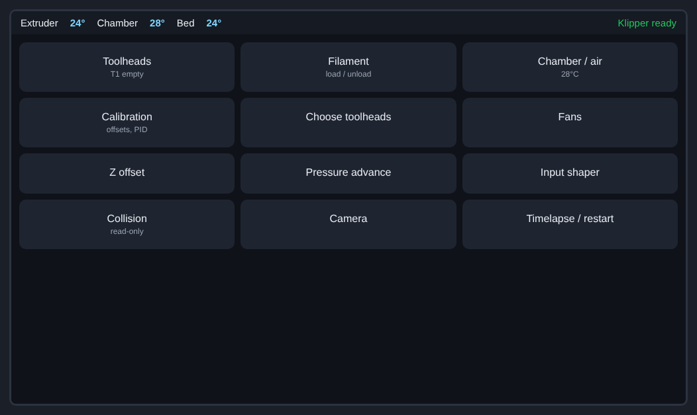
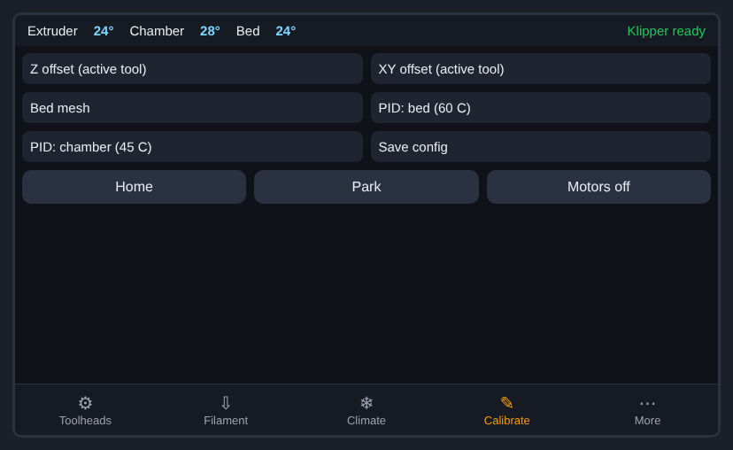

<div align="center">

# WonderMaker ZR Ultra / Ultra-S: Raspberry Pi replacement

**Replace screen/host board with a Raspberry Pi running WonderMaker's own Klipper, Moonraker and Fluidd.**

[](LICENSE) 

</div>

## Contents

1. [Disclaimer](#disclaimer-use-at-your-own-risk)
2. [Hardware](#2-hardware)
3. [Install](#3-install)
4. [When the main board is connected](#4-when-the-main-board-is-connected)
5. [Fluidd panel and touchscreen](#5-fluidd-panel-and-zr-tools)
6. [Go back / uninstall](#6-go-back--uninstall)
7. [Troubleshooting](#7-troubleshooting)
8. [Repository layout](#8-repository-layout)
9. [Credits and license](#9-credits-and-license)

## Disclaimer (use at your own risk)

This is a community project, not made or supported by WonderMaker. It is provided "as is", without warranty. **It has been tested only with a fake home folder and a synthetic disk image, not yet on a real printer**: the author is waiting for a replacement main board. Please report what works and what does not.

The installer never flashes any board and never starts Klipper unless you ask for it. You still work on a printer with mains power and heaters: you are responsible for what you connect and run.

## What you get

| | |
|---|---|
| A Pi that replaces the dead screen/host board | Raspberry Pi 4 or 5 (64-bit) with Raspberry Pi OS Bookworm |
| WonderMaker's own software, copied from your printer | Klipper and Moonraker forks, your `printer.cfg`, calibration, factory settings |
| Python 3.9 next to Bookworm's 3.11 | needed for WonderMaker's compiled modules |
| Exact package versions of WonderMaker's `klippy-env` and `moonraker-env` | pinned lists in `config/`, read from the factory image |
| Webcams and timelapse | crowsnest and Moonraker timelapse, the versions WonderMaker ships |
| Fluidd with a **Toolheads** panel | four toolheads, chamber, air filter, doors, print with colours, filament mapping |
| Safe by default | Moonraker and Fluidd work right away, **Klipper stays off** until you connect the main board |
| Optional touchscreen | KlipperScreen with a **ZR Tools** page, if you connect a screen to the Pi (**not yet tested on hardware**) |


## 2. Hardware

### 2.1 What you need

- A Raspberry Pi 4 or 5 (64-bit), its official power supply, an SD card of 16 GB or more.
- **Raspberry Pi OS Lite (64-bit), Debian 12 "Bookworm"**, written with Raspberry Pi Imager. Newer Raspberry Pi OS releases are based on Debian 13 "Trixie" and are **not tested**: in the Imager choose **Raspberry Pi OS (other) → Raspberry Pi OS (Legacy, 64-bit) Lite**, which is the Bookworm release. Not the 32-bit image and not the Trixie one. (The Desktop version also works, but Lite is all you need: you use Fluidd in a browser.) In the imager's settings set the **username to `t13dp`** (WonderMaker's software has `/home/t13dp` built in), enable SSH, and set your Wi-Fi or use a cable.
- The **replacement main board** (WM-ZR-D V1.2): it carries the Klipper USB-CAN bridge (USB id `1d50:606f`), and the toolheads and filament hub stay on its CAN bus.
- A **USB-A to JST-XH 2.54 mm 4-pin cable**, bought or made, from the Pi's USB-A port to the red 4-pin connector of the main board. A ready-made one must be **re-pinned** to the board's order (DM, DP, G; leave VIN empty). **VIN is 24 V: cut or do not connect the red wire, never feed it to the Pi.** See [docs/WIRING.md](docs/WIRING.md).
- The WonderMaker software: from **your own printer** (reachable old board, a disk image, or a folder made earlier) or the factory files in this repo (see 3.1). 

### 2.2 How it is connected


**Careful:** the red connector's VIN pin carries 24 V. Only DM, DP and G go to the Pi's USB-A plug.

The old board's job (screen, Wi-Fi, running Klipper) moves to the Pi. Step by step with photos: [docs/WIRING.md](docs/WIRING.md). The main board, CAN bus, toolheads and hub are untouched. Details and checks: [docs/HARDWARE.md](docs/HARDWARE.md).

### 2.3 What is not covered

The original touchscreen of the Ultra-S is not replaced one-to-one. Use Fluidd in a browser, or connect a screen to the Pi (see 5.1 Touchscreen).

## 3. Install

Log in to the Pi as `t13dp` and:

```bash
sudo apt-get update
sudo apt-get install -y git
cd ~
git clone https://github.com/ducati1198/wm-ultra-rpi.git
cd wm-ultra-rpi
chmod +x installer.sh
./installer.sh
```

> **"destination path 'wm-ultra-rpi' already exists"?** You already downloaded it once. Do not clone again. Update the folder instead:
>
> ```bash
> cd ~/wm-ultra-rpi
> git pull
> ./installer.sh --update
> ```


### 3.1 The questions

The installer first asks **which printer you have** (ZR Ultra or ZR Ultra-S; or give `--model ultra|ultra-s`) and then **where the WonderMaker software is**:

1. **The old board is still reachable (SSH). Recommended.** If your WonderMaker screen board still boots and is on your network, use this one: the installer fetches `printer_data` (config, calibration, saved variables), `klipper`, `moonraker`, `fluidd` and the factory settings from it, so the Pi gets exactly what your printer ran, with your own settings and the original compiled modules. Find its IP in your router, then `./installer.sh --from-board <IP>`. The default WonderMaker login is user `t13dp`, password `TM88888`. Only `tar` is run there, nothing is written.
2. **A disk image of its card or eMMC** (`.img` or `.img.gz`). Needs `e2fsprogs` and free space about the unpacked image (about 8 GB for the Ultra-S image). No printer needed.
3. **A stage folder** (`klipper.tgz`, `moonraker.tgz`, `data.tgz`) made by `scripts/pull_from_board.sh` or `scripts/extract_from_image.sh`.
4. **Nothing at all: the factory files inside this repository** (`--from-github`). The repo carries the original Klipper and Moonraker (both GPL v3, license included) and the factory settings, with SHA256 checksums that are verified first. There is a folder for each model: [`factory/ultra/`](factory/ultra) and [`factory/ultra-s/`](factory/ultra-s). See [factory/README.md](factory/README.md).

   WonderMaker's **5 compiled modules** (`cs1237`, `hx711`, `heater_air_core`, `heater_feng`, `xy_offset_calibrator_core`: heaters, load cells, calibration) are bundled in the repo too, copied unchanged from an Ultra-S and checked against their factory checksums. They are WonderMaker's binaries (no published license): see the takedown note in [factory/README.md](factory/README.md). `--modules DIR` uses your own copies instead.

### 3.2 What it does

| Step | What and why |
|---|---|
| Checks | user is `t13dp`, 64-bit ARM, enough disk space |
| Model | asks Ultra or Ultra-S and sets `printer.cfg` for it (the Ultra-S includes `zru-s.cfg`: chamber heater, air filter fan, door sensors). This applies to every source; your old `printer.cfg` is saved as `printer.cfg.wm-model-bak` if it had to change |
| Packages | nginx, can-utils, build tools, libraries (apt) |
| Groups | `moonraker-admin`, plus `dialout` and `plugdev` |
| Python 3.9 | installed with `uv` into `~/.pythons` |
| Unpack | `klipper`, `moonraker`, `printer_data`, `fluidd`, factory settings into `~`. Anything already there is moved to `~/wm-rpi-backup/old-<time>/` |
| Environments | `klippy-env` and `moonraker-env` built from `config/klippy-requirements.txt` and `config/moonraker-requirements.txt` (exact versions of WonderMaker's image). The environments themselves are not stored in git: they are machine-built folders, so they are rebuilt on the Pi |
| Module check | tries to import the 10 compiled WonderMaker modules and tells you if one fails |
| Services | `moonraker.service` enabled; `klipper.service` installed but **disabled and stopped** |
| nginx | Fluidd on port 80 with the websocket, API and webcam routes |
| CAN rule | brings `can0` up at 1 Mbit when the main board appears |
| Fluidd panel | optional, see 5. The panel is **downloaded from [wm-ultra-fluidd-acepro-panel](https://github.com/ducati1198/wm-ultra-fluidd-acepro-panel) every time** (so you always get its latest), checked against the checksum published next to it. It needs internet (no copy is kept in this repo); if the download fails the web page is skipped with a warning and `--update` retries. `--update` installs a newer panel when there is one |
| Timelapse | `ffmpeg` and `moonraker-timelapse` (latest release; it is the same version WonderMaker ships), downloaded from mainsail-crew on GitHub |
| Webcams | `crowsnest` v5.0.12 (latest release; WonderMaker ships a 2023 version), installed unattended (builds `ustreamer`); your camera goes in `~/printer_data/config/crowsnest.conf` |

### 3.3 Safety checks

- It never flashes any firmware and never writes to the old board.
- At the very end the installer **enables and starts Klipper, Moonraker, nginx and crowsnest**, so everything comes back after a reboot. It first runs the checks (USB bridge, can0, CAN devices, config, modules); a failed check is reported, and Klipper then shows the problem until you fix it. `--no-start` starts nothing; `--first-start` later does the checks and stops without starting if one fails.
- Nothing runs on a schedule and nothing is backed up unless you ask (`--backup`).
- A running print stops `--update`, `--repair`, `--restore`, `--undo` and `--first-start` (override with `--force`).
- It replaces the Fluidd folder only after the zip's checksum matches, keeps your `config.json`, and saves the old Fluidd.
- `--dry-run` goes through everything and changes nothing.

### 3.4 Command table

| Command | What it does |
|---|---|
| `./installer.sh` | install (asks first) |
| `./installer.sh --from-board IP` / `--from-image FILE` / `--from-stage DIR` | choose the source without being asked |
| `./installer.sh --from-github --model ultra --modules DIR` | use the factory files in this repo; modules from your printer |
| `./installer.sh --check` | report problems, change nothing |
| `./installer.sh --dry-run` | show the plan and what would change |
| `./installer.sh --first-start` | checks with the main board connected, fixes `canbus_uuid` (asks, keeps a copy), then enables and starts Klipper and the other services |
| `./installer.sh --hw-test` | read-only live test: USB bridge, can0, CAN devices, camera picture, services |
| `./installer.sh --doctor` | finds problems, explains them, offers a fix for each (asks first) |
| `./installer.sh --repair` | puts back services, nginx files, can0 rule, groups; your data is untouched |
| `./installer.sh --update` | after `git pull`: refreshes services, packages, panel, add-ons; shows what changed; keeps `printer_data` |
| `./installer.sh --undo [DIR]` | puts back the folders the installer moved aside (latest by default) |
| `./installer.sh --backup [DIR]` | saves config, calibration and database to a private `.tgz` (only when you run it) |
| `./installer.sh --restore FILE` | restores such a backup after making a safety copy |
| `./installer.sh --support-bundle` | scrubbed logs and config in one `.tgz` for asking for help (passwords, tokens, Wi-Fi, private IPs removed) |
| `./installer.sh --no-start` / `--force` | do not start Klipper at the end / ignore an active print |
| `./installer.sh --disable-klipper` | stop Klipper and disable it |
| `./installer.sh --uninstall` | remove what the installer added to the system |
| `scripts/board_check.sh` | read-only: main board on USB, can0, CAN devices, services, Moonraker |

### 3.5 Open Fluidd

After the install, open `http://<pi address>/`. Fluidd shows "Klippy disconnected" until Klipper runs. That is expected.

## 4. When the main board is connected

1. Power the printer, connect the USB cable between Pi and main board (see [docs/WIRING.md](docs/WIRING.md)).
2. Run `./installer.sh --first-start`. It checks the USB bridge (`1d50:606f`), brings `can0` up, asks the CAN bus which devices answer, and compares them with `canbus_uuid` in your config.
3. A **new main board may have a new `canbus_uuid`**. If the bus shows one device the config does not know, the installer offers to put it into `wm_zru_mcu.cfg` (a copy of the old file is kept in `~/wm-rpi-backup/uuid-*`). Toolhead and hub uuids are only reported, never changed.
4. If every check passes it enables and starts Klipper, Moonraker, nginx and crowsnest. If not, the failing checks are listed and nothing is started.
5. Do not run heaters or moves unattended on the first start.

## 5. Fluidd panel and ZR Tools

**Without an ACE Pro** (the default):


**With an ACE Pro** (the same Fluidd build: the installer downloads the newest panel straight from [wm-ultra-fluidd-acepro-panel](https://github.com/ducati1198/wm-ultra-fluidd-acepro-panel); run that repo's `installer.sh` to add the ACE Pro driver, and the ACE section appears in the Toolheads card):


Full dashboard without an ACE Pro:


The Fluidd build from [wm-ultra-fluidd-acepro-panel](https://github.com/ducati1198/wm-ultra-fluidd-acepro-panel) adds the Toolheads card (toolhead status, colours and materials, chamber, air filter, doors, **Print with colours**) and the **Choose toolheads** window at print start, shown only when a colour or material does not match.




Without an Anycubic ACE Pro the ACE parts stay hidden. If you add one later, use [wm-ultra-fluidd-acepro-panel](https://github.com/ducati1198/wm-ultra-fluidd-acepro-panel).

### 5.1 Touchscreen (KlipperScreen + ZR Tools)

> **Not yet tested on hardware.** It was built against the KlipperScreen documentation and checked with automated tests, but nobody has run it on a Pi with a screen yet. Please report what you see.

The installer asks **"Add a touchscreen?"** (default yes). Skip it with `--screen off`. Options:

| Option | Meaning |
|---|---|
| `--screen on\|off` | add or skip the touchscreen |
| `--screen-layout tabs\|grid` | `tabs` (default): big touch buttons with bottom tabs. `grid`: cards on a home page |
| `--screen-backend x11\|weston\|cage` | graphics stack, default `x11` |
| `--screen-test` | read-only: shows the screen and touch device found |

What it does: installs [KlipperScreen](https://github.com/KlipperScreen/KlipperScreen) pinned to one tested commit (`34610ce`, so a later upstream change cannot break it), copies the ZR Tools panel into it, adds the helper macros (`zr_tools.cfg`) to `printer.cfg` and enables the `KlipperScreen` service. KlipperScreen's own home screen and menus stay as they are; ZR Tools is one extra menu entry.

The screen is detected for you: size from the video output (800x480 and smaller screens use compact buttons, 1024x600 and larger use comfortable ones) and the touch device through udev. On a 5 inch and a 7 inch screen both layouts work.

**ZR Tools pages:** Toolheads (select, heat, load, unload, purge, colour, material), Filament, Climate (chamber, air filter), Calibrate (only the macros that exist on your printer: Z and XY offsets, bed mesh, PID, wipe position, input shaper via the accelerometer), **ACE Pro** (only when an ACE Pro is present: slots, load/unload, feed assist, dryer presets, endless spool), More (collision detection settings, **read-only**; timelapse; restart; system page with Pi temperature, power flags, can0, Klipper state and a backup button) and Settings. Fan, Z offset, pressure advance and camera use KlipperScreen's own pages. The emergency stop is KlipperScreen's own button, shown while printing.

**Settings page:** layout (tabs/grid), density (auto/compact/comfortable) and light/dark theme. They are stored in `~/printer_data/config/zr_screen.conf` (not in KlipperScreen's own settings). You can also change the layout with `./installer.sh --screen-layout grid`.

**What it looks like** (drawn illustrations of the intended look, not photos; real screens will differ in small details):

Layout `tabs` (default), 7 inch 1024x600:



Layout `grid`:



ACE Pro page (only shown when an ACE Pro is present):


Settings page, and the Calibrate page on a 5 inch 800x480 screen (compact):




**Rotation** is an operating-system setting, not a ZR Tools one. On X11 use `xrandr --output <name> --rotate left` (and a matching touch matrix); for Weston, `transform=90` in `weston.ini`. See the KlipperScreen documentation.

`--update`, `--repair` and `--doctor` copy the panel files back if a KlipperScreen update removed them. Switching the WonderMaker screen board itself into a KlipperScreen is a later step and is not part of this.

## 6. Go back / uninstall

- `./installer.sh --uninstall` removes the services, nginx files and can0 rule the installer added. Your folders in `~` stay.
- Moved folders are in `~/wm-rpi-backup/`.
- Nothing was changed on the old board or on any firmware, so there is nothing to restore there.

## 7. Troubleshooting

| Problem | What to try |
|---|---|
| "you are user ..., expected t13dp" | Create the card again with username `t13dp`. WonderMaker's paths are fixed to `/home/t13dp`. |
| Can't read the old board | Check IP, power and the password. Or use an image (`--from-image`). |
| A compiled module "does not import" | Python must be 3.9 and the CPU 64-bit ARM. Check: `cd ~/klipper/klippy/extras && ~/klippy-env/bin/python -c 'import cs1237'` |
| Fluidd blank / old page | Hard-refresh (Ctrl/Cmd+Shift+R). Check `sudo nginx -t` and `systemctl status nginx`. |
| No picture from the camera | `ls /dev/v4l/by-id/`, put that path on the `device:` line of `~/printer_data/config/crowsnest.conf`, `sudo systemctl restart crowsnest` |
| Moonraker does not answer | `journalctl -u moonraker -n 50` |
| No `can0` | Main board not powered or not on USB. `lsusb` should show `1d50:606f`. |
| Klipper "mcu ... uuid" error | New board, new `canbus_uuid` (see 4). |

## 8. Repository layout

```
installer.sh            the Pi installer
factory/ultra/          WonderMaker ZR Ultra: Klipper, Moonraker, settings, scripts, checksums
factory/ultra-s/        WonderMaker ZR Ultra-S: same, with the chamber/air-filter/door settings on
scripts/                pull_from_board.sh, extract_from_image.sh, stage_from_repo.sh, board_check.sh
config/                 systemd units, nginx files, can0 udev rule, pinned Python requirements, crowsnest template, addon version pins
zr_tools/               ZR Tools KlipperScreen panel (copied by the installer)
docs/                   HARDWARE.md and images
tests/run_tests.sh      tests (fake home, synthetic disk image)
```

`factory/` holds WonderMaker's Klipper and Moonraker (GPL), the factory settings, helper scripts, and their compiled modules and MCU firmware (WonderMaker's binaries, see [factory/README.md](factory/README.md)). Your own calibration is not in the repository.

## 9. Credits and license

Klipper, Moonraker and Fluidd are their own projects and licenses. The Anycubic ACE Pro and WonderMaker are trademarks of their owners; this project is unaffiliated. Layout inspired by [acepro-any-klipper](https://github.com/ducati1198/acepro-any-klipper). This repository is under the GPL v3, see [LICENSE](LICENSE).
