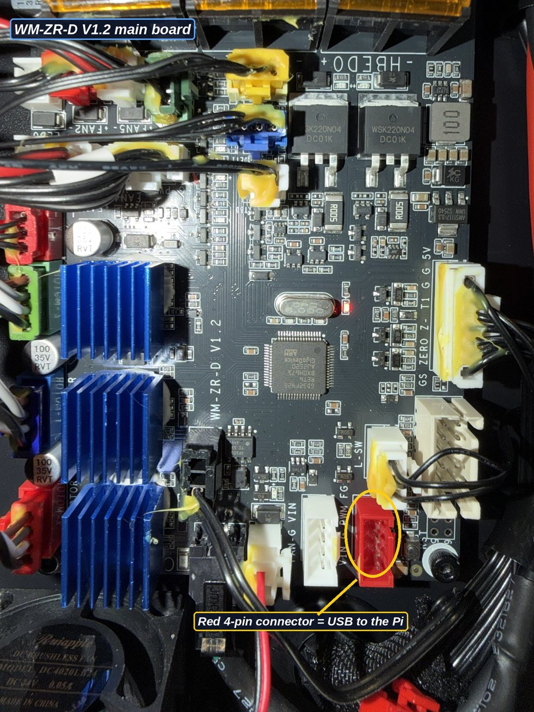
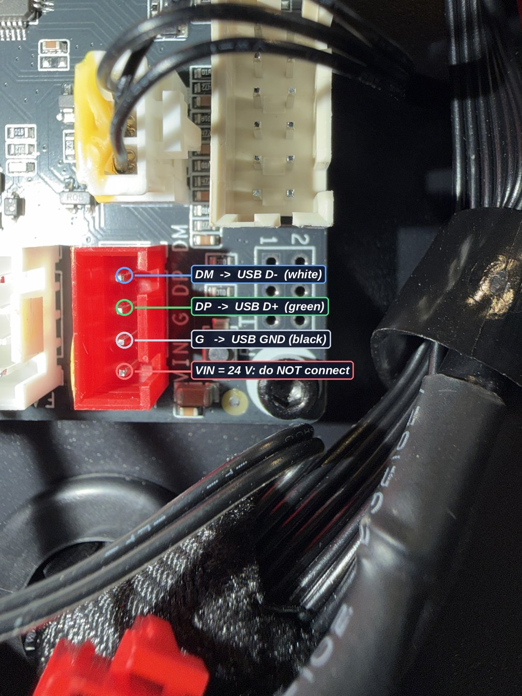
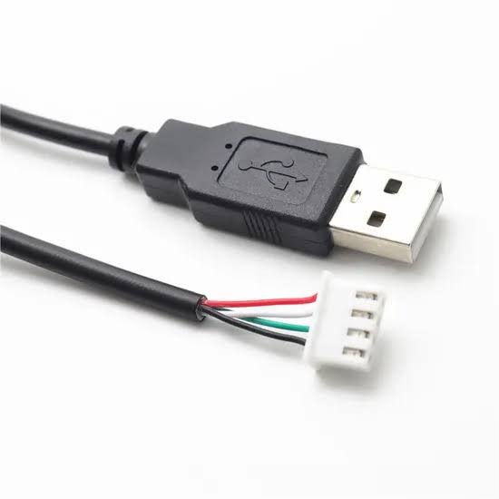
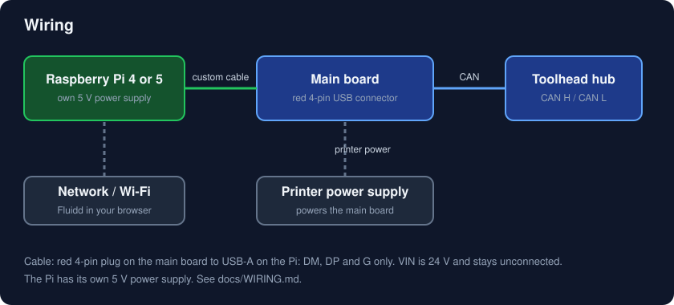

# Wiring the main board to the Raspberry Pi

> Use at your own risk. This is a **custom cable** and one wrong wire (24 V into the Pi's USB port) can destroy the Pi. Read the whole page first, measure before you plug in.

Board: **WM-ZR-D V1.2** (photos below). The Pi connects to the **red 4-pin connector** next to the reset button. It is the Klipper USB connection of the main board (it shows up on the Pi as USB device `1d50:606f`).

## The connector

The four pins are printed on the board, top to bottom in the photo:

| Board pin | What it is | Goes to the Pi's USB-A plug |
|---|---|---|
| **DM** | USB data minus (D-) | pin 2, white wire |
| **DP** | USB data plus (D+) | pin 3, green wire |
| **G** | ground | pin 4, black wire |
| **VIN** | **24 V** supply | **nothing. Do not connect.** Cut the wire off or leave the pin empty and insulate it |

The red wire of a USB cable (5 V, pin 1) is **not used** either: the Pi has its own power supply, and the main board gets its power from the printer.

## You need a USB-A to JST-XH 2.54 mm cable

The Pi has a normal USB-A port and the main board has a small 4-pin **JST-XH, 2.54 mm pitch** connector, so you must **buy or make a cable** that joins them. Compare the plug with the connector on your board before you order.

**Option A: buy a ready-made "USB-A to JST-XH 2.54 4-pin" cable** (like the one above). The wire order of these cables is made for other uses, **so you must re-pin it** to match the main board:

1. Do not trust the colours or the pin order of the plug. Use a multimeter to find which wire of the plug goes to which USB contact.
2. Pull each pin out of the plug (lift the small latch on the pin with a needle and pull it from the back) and push it into the right position, so the plug matches the table above: **DM, DP, G, VIN** from the top in the photo.
3. **VIN is 24 V: that position must stay empty.** The USB cable's red wire (5 V) goes nowhere: **cut it off at the plug and insulate the end, or just do not put it in the plug.** Never connect the red 5 V wire to the board's VIN pin, and never let 24 V reach the USB side.
4. Check the finished cable with the multimeter (continuity: USB D- to DM, D+ to DP, GND to G, nothing to VIN) before plugging in.

**Option B: make it yourself** from a cut USB-A cable and a JST-XH 4-pin housing with crimp pins (a small crimp tool is needed). Wire **DM to white, DP to green, G to black**. Leave the VIN position empty. Cut off and insulate the red wire.

Either way:

- The plug is keyed. Put it in the right way round; DM is at the top in the photo.
- Keep the cable short and away from heater and motor wires.
- **Cut the red wire or leave it unconnected. Nothing from the Pi's 5 V should reach the board, and the board's 24 V VIN must never reach the Pi.**

## Before the first power-up

1. With the printer on and **nothing connected** to the red connector, measure with a multimeter: **VIN to G should read about 24 V**. This confirms which pin is which.
2. Also confirm **DM and DP read about 0 to 3.3 V, never 24 V**.
3. Plug the cable into the main board only, then the Pi's USB-A. Power the printer first, then the Pi (own 5 V supply).
4. On the Pi: `scripts/board_check.sh`. `1d50:606f` must appear in `lsusb`, and `can0` must come up.

## If it does not show up

| Symptom | Check |
|---|---|
| No `1d50:606f` | D+ and D- swapped (DM and DP), a bad crimp, G not connected, main board not powered |
| `can0` missing or down | udev rule installed (`ls /etc/udev/rules.d/99-wm-can0.rules`), unplug and replug the cable |
| Bus query lists nothing | CAN cable to the hub, hub powered |

## What stays as it is

The CAN cable to the toolhead hub, the motors, heaters and everything else on the main board stay exactly as they were on the printer. Only the old board's cable is replaced by this one.
