# ZR Tools, design A (saved for a later update)

A redesign of every ZR Tools KlipperScreen page: tall rounded toolhead cards with status chips, round
spools drawn in the filament colour, thin temperature bars, a rounded bottom tab bar, and a detail page
with a spool card on the left and a 3x3 grid of big actions on the right.

**This is not installed by any script.** `install_zr_tools.sh` and `scripts/screen_board.sh` still use the
files in `zr_tools/`. This folder only keeps the work for a future update.

Tested on the WonderMaker screen board (800x480) with a simulated Klipper (the screenshots below).
Not yet tested on hardware with a real printer, on a 7 inch (1024x600) screen, or with the other
Screen settings options (card grid, light theme, flat/bold/classic looks).

Files: `zr_tools.py`, `zr_views.py`, `zr_logic.py` (same names as in `zr_tools/`; `zr_logic.build_css` now takes
a density argument). To try it later, copy the three files over `~/KlipperScreen/panels/` and restart KlipperScreen.
Back up the old files first.

| | |
|---|---|
| 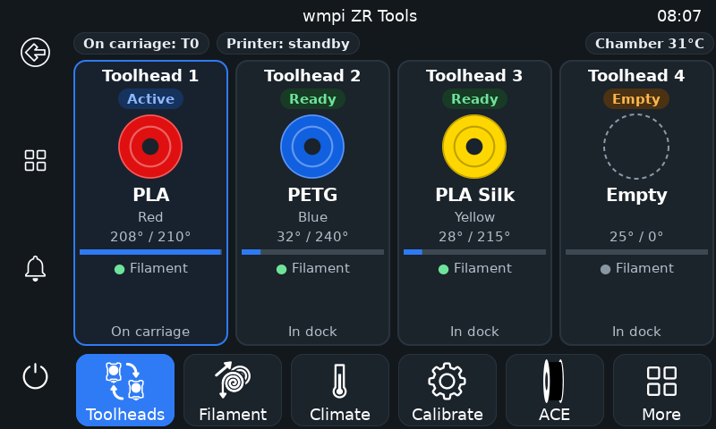 | 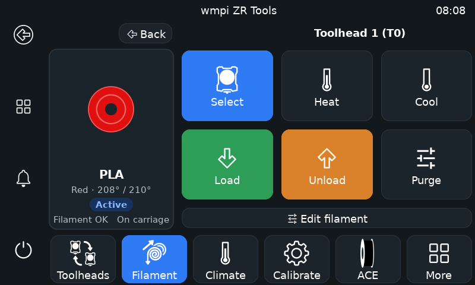 |
| 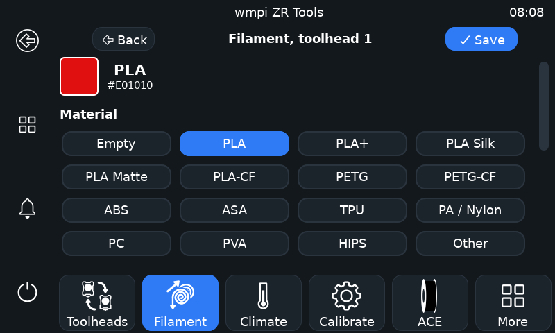 | 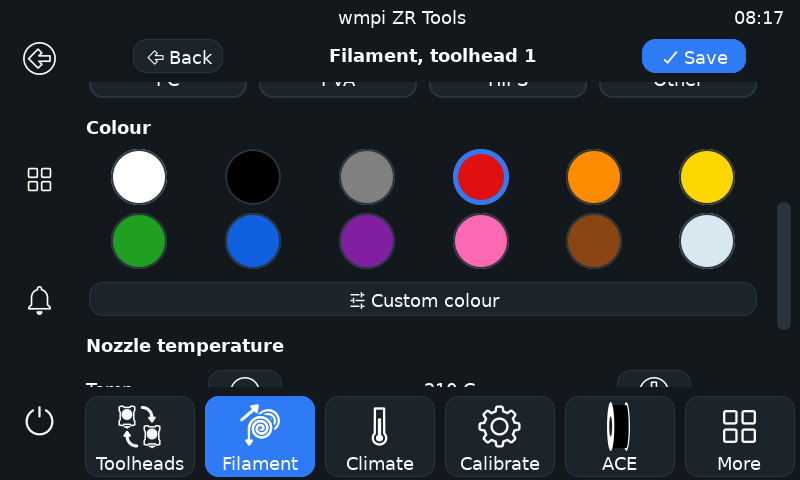 |
| 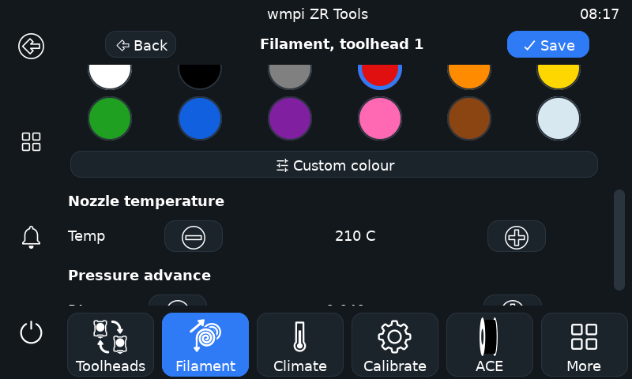 | 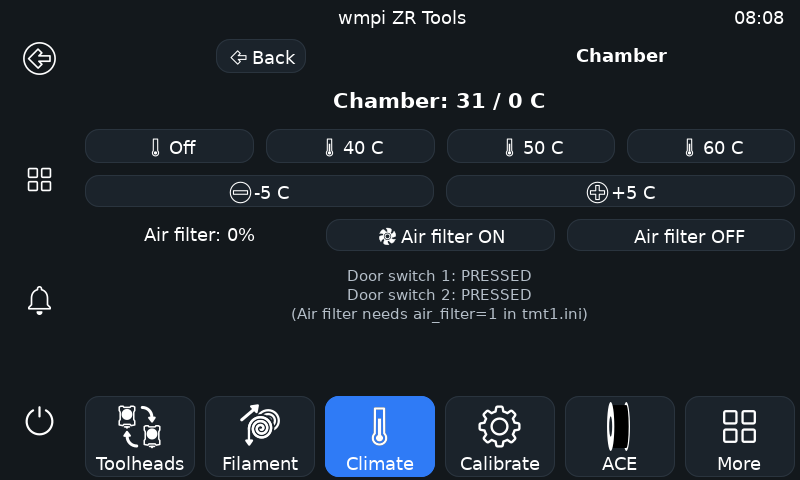 |
| 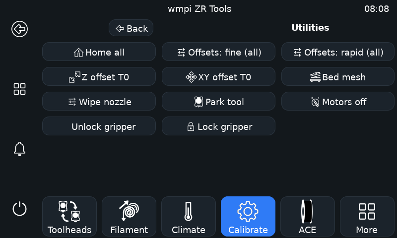 | 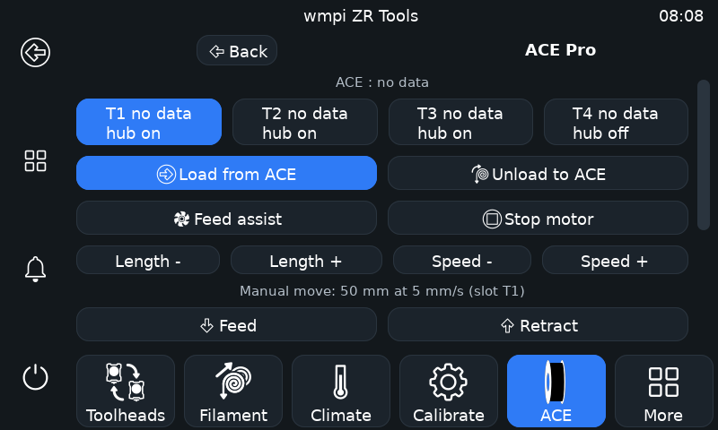 |
| 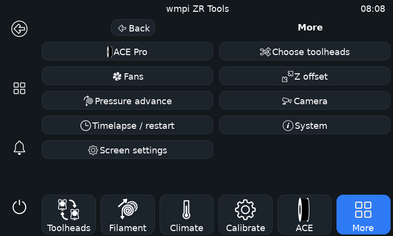 | 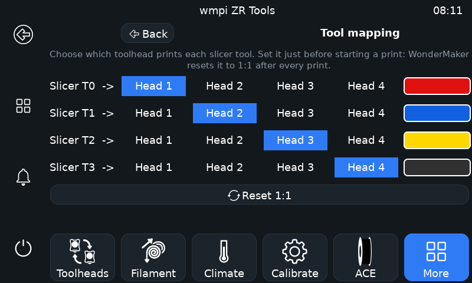 |
| 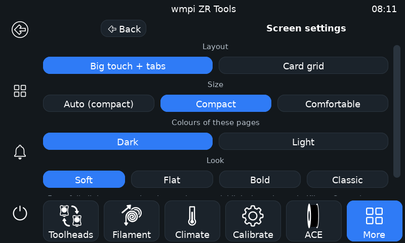 | 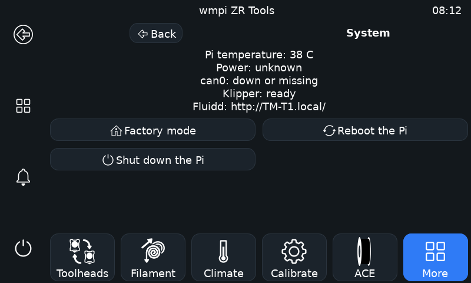 |

The ACE Pro page shows "no data" because the simulated Klipper had no ACE state.
